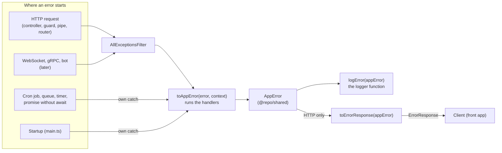
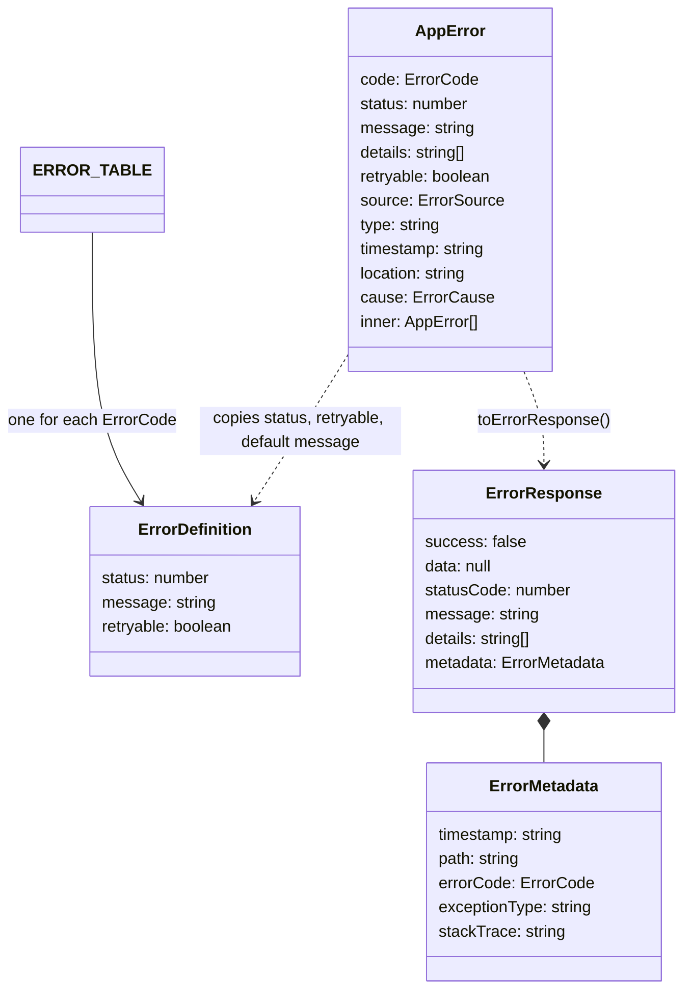
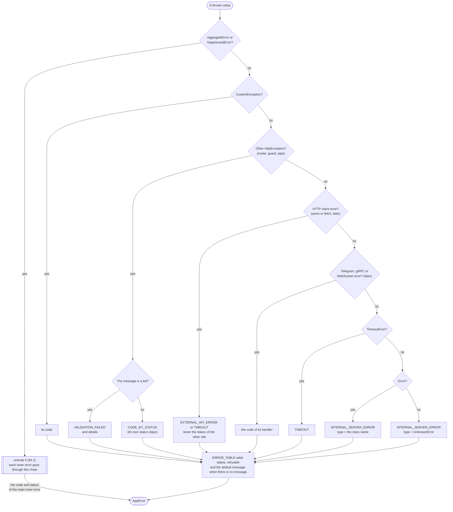
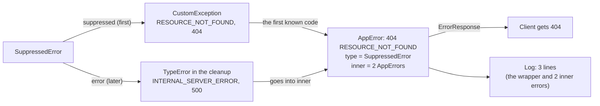
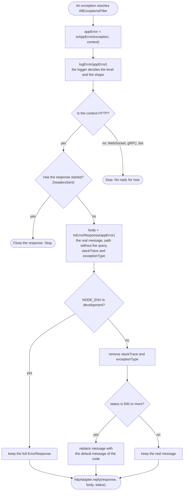
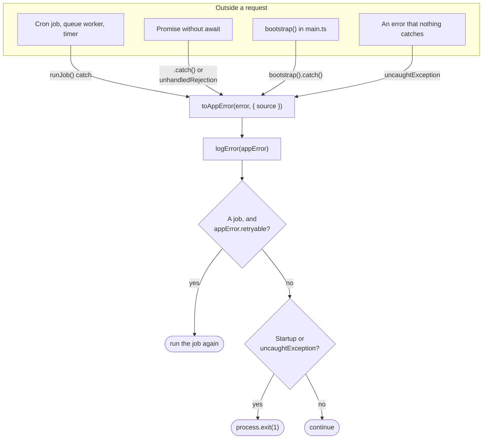

# Error handling improvements

Status: draft for your review. There is no spec and no code yet.

This page combines 3 inputs:

- your message of 2026-11-24 in the project thread,
- [`my-thought.md`](my-thought.md) ("my-thought 1" is item 1 of its list),
- the earlier review of `AllExceptionsFilter` ("earlier 1" is its improvement 1).

The current plan is in [`error-handling.md`](error-handling.md) and in the draft change [`261124-0853`](../openspec/changes/261124-0853-global-error-handler/proposal.md).

Next step: you edit this page. Then we write the spec.

## 1. The improvements

| #   | Improvement                                                                                                                                                                                                     | Source                                          |
| --- | --------------------------------------------------------------------------------------------------------------------------------------------------------------------------------------------------------------- | ----------------------------------------------- |
| 1   | Each error becomes one `AppError` object. A small handler converts each error type.                                                                                                                             | my-thought 1                                    |
| 2   | One table of error codes. Each code has a status, a default message and a retry flag.                                                                                                                           | my-thought 2, your message                      |
| 3   | Each error response has an `errorCode`. A NestJS exception gets the code of its status.                                                                                                                         | my-thought 4                                    |
| 4   | `AppError` and the response keep the real message (a custom message or a validator message), so the user can fix the problem. Outside development, a 5xx response gets the default message of its code instead. | your messages of 2026-11-24 and 2026-11-26      |
| 5   | `exceptionName` is removed.                                                                                                                                                                                     | my-thought 3                                    |
| 6   | Logging is a separate function. The filter gets it in its constructor. A log line has no line breaks.                                                                                                           | my-thought 5, your message                      |
| 7   | The filter adds the debug fields to each response. In `development`, the body stays full. In other environments, it removes them and then checks the status.                                                    | my-thought 6                                    |
| 8   | A context that is not HTTP (WebSocket, gRPC, bot): the filter makes the `AppError` and logs it. It sends no reply.                                                                                              | your message (changes earlier 1)                |
| 9   | The response has already started: the filter only logs and closes it.                                                                                                                                           | earlier 2, no change                            |
| 10  | `path` has no query string, in the response and in the log.                                                                                                                                                     | earlier 4, no change                            |
| 11  | The names of the security tests have the SEC IDs of the security guide.                                                                                                                                         | earlier 6, no change                            |
| 12  | Code that runs outside a request (cron, queue, timer, promise without `await`, startup) uses the same `AppError` and logger.                                                                                    | earlier review (what is not caught)             |
| 13  | `AggregateError` and `SuppressedError` are unwrapped. Each inner error is logged. The first inner error with a known code gives the code and the status (§4.1).                                                 | your question of 2026-11-24 in the project chat |

I found no conflict between your message and `my-thought.md`. Some points conflict with the draft spec or are not clear. They are in §9.

## 2. Big picture



- The filter is only one entry point. `toAppError` and `logError` are plain functions in `apps/back/src/common/errors/`, so a cron job or `main.ts` can use them too.
- `AppError` is the inside view of an error: it has all the details. `ErrorResponse` is the outside view: only the safe fields.

## 3. Shared types (`@repo/shared`)

The front app and the back app use the same types. Each value is plain data (no class, no `Error` object), so `JSON.stringify` works on it.



### 3.1 The table of error codes

`packages/shared/src/error-codes.ts`. This is your `STATUS_BY_CODE` (my-thought 2), with the default message and the retry flag added.

| Code                      | Status | Default message                              | Retry | Who uses it                     |
| ------------------------- | ------ | -------------------------------------------- | ----- | ------------------------------- |
| `BAD_REQUEST`             | 400    | The request is not valid.                    | no    | NestJS 400                      |
| `VALIDATION_FAILED`       | 400    | The request data is not valid.               | no    | `ValidationPipe` (message list) |
| `UNAUTHORIZED`            | 401    | Sign in to continue.                         | no    | NestJS 401                      |
| `FORBIDDEN`               | 403    | You do not have access.                      | no    | NestJS 403                      |
| `NOT_FOUND`               | 404    | The route does not exist.                    | no    | NestJS 404, unknown route       |
| `RESOURCE_NOT_FOUND`      | 404    | The item was not found.                      | no    | `CustomException`               |
| `RESOURCE_ALREADY_EXISTS` | 409    | The item already exists.                     | no    | `CustomException`               |
| `TOO_MANY_REQUESTS`       | 429    | Too many requests. Try again later.          | yes   | NestJS 429 (rate limit)         |
| `INTERNAL_SERVER_ERROR`   | 500    | Sorry, something bad happened. Try again.    | no    | each unexpected error           |
| `EXTERNAL_API_ERROR`      | 502    | An external service failed. Try again later. | yes   | HTTP client handler             |
| `TIMEOUT`                 | 504    | The request took too long. Try again later.  | yes   | `TimeoutError`                  |

```ts
export const ERROR_TABLE: Record<ErrorCode, ErrorDefinition> = {
  RESOURCE_NOT_FOUND: { status: 404, message: 'The item was not found.', retryable: false },
  EXTERNAL_API_ERROR: { status: 502, message: 'An external service failed. Try again later.', retryable: true },
  // ...
};

/** The code of a NestJS exception that has no code of its own (my-thought 4). */
export const CODE_BY_STATUS: Partial<Record<number, ErrorCode>> = {
  400: 'BAD_REQUEST',
  401: 'UNAUTHORIZED',
  403: 'FORBIDDEN',
  404: 'NOT_FOUND',
  429: 'TOO_MANY_REQUESTS',
};
```

One status can have more than one code (`404`: `NOT_FOUND` and `RESOURCE_NOT_FOUND`). So `CODE_BY_STATUS` gives one default code for each status.

The default message has two jobs:

- An error with no message of its own gets it. For example, `new CustomException(ErrorCodes.RESOURCE_NOT_FOUND)`, or a `ValidationPipe` error (its list goes to `details`).
- Outside development, it replaces the real message of each 5xx response (§5). The real message of a 5xx error can show internal details (a file path, a database message).

The front app can show the default message too, because the table is shared.

### 3.2 `AppError`

`packages/shared/src/app-error.ts`:

```ts
export type ErrorSource = 'http' | 'ws' | 'rpc' | 'bot' | 'job' | 'startup' | 'process';

export interface AppError {
  code: ErrorCode;
  status: number; // from ERROR_TABLE. A NestJS exception keeps its own status.
  message: string; // the real message. Without one, the default message of the code.
  details?: string[]; // the list of validation messages (§9, Q1)
  retryable: boolean; // from ERROR_TABLE
  source: ErrorSource; // where the error happened
  type: string; // the class name: 'TypeError', 'NotFoundException', 'UnknownError'
  timestamp: string; // ISO 8601
  location?: string; // the HTTP path without the query, or the job name
  cause?: { message: string; stack?: string }; // the original error and its stack. Log only, never in a response.
  inner?: AppError[]; // the inner errors of AggregateError and SuppressedError (§4.1). Log only.
}
```

Use it in code for retries and other runtime decisions: `if (appError.retryable) { ... }`.

The front app can use `AppError` too: its API client can turn an `ErrorResponse` or a network error into an `AppError`. That is a later front change.

### 3.3 `ErrorResponse`

`packages/shared/src/api-response.ts`:

```ts
export interface ErrorResponse extends BaseResponse<null> {
  success: false;
  message: string; // the real message. Outside development, a 5xx response gets the default message.
  details?: string[]; // §9, Q1
  metadata: ErrorMetadata;
}

export interface ErrorMetadata {
  timestamp: string;
  path: string; // without the query string
  errorCode: ErrorCode; // always set now
  exceptionType?: string; // development only (§9, Q4)
  stackTrace?: string; // development only
}
```

`exceptionName` is removed (my-thought 3). The only case where it was different from `exceptionType` was `AbortError` and `TimeoutError` (both are `DOMException`). Now `TimeoutError` has its own code, and `type` takes the `name` of a `DOMException`.

## 4. Handlers: from any error to `AppError`

A handler knows one error type. It picks the code and reads the real error and its message. The table gives the status, the retry flag and the default message, so a handler cannot invent a status.

```ts
export interface ErrorHandler {
  canHandle(error: unknown): boolean;
  handle(error: unknown): {
    code: ErrorCode;
    type: string;
    status?: number; // only a NestJS exception has its own status
    message?: string; // the real message, when the error has a text
    details?: string[];
    cause?: { message: string; stack?: string };
  };
}
```

`toAppError()` asks the handlers in order. The first handler that says "yes" wins. The last two handlers always say "yes", so each value gets an `AppError`.



| Handler                                                          | When                                               |
| ---------------------------------------------------------------- | -------------------------------------------------- |
| `AggregateError`, `SuppressedError` (a step before the handlers) | now                                                |
| `CustomException`                                                | now                                                |
| `HttpException`                                                  | now                                                |
| HTTP client (axios)                                              | the first change that calls a job site or LinkedIn |
| Telegram, gRPC, WS                                               | the change that adds the bot, gRPC or WebSocket    |
| `TimeoutError`                                                   | now                                                |
| `Error`, other values                                            | now (the last two, they always match)              |

A status that is not in `CODE_BY_STATUS` (for example `413`) keeps its status. Its code is `BAD_REQUEST` (4xx) or `INTERNAL_SERVER_ERROR` (5xx).

A new error type needs only a new handler in the list. The filter does not change.

### 4.1 Errors that hold other errors

Two built-in errors hold other errors inside them:

| Error             | Where it comes from                                                                                                                            | Inner errors                                                        |
| ----------------- | ---------------------------------------------------------------------------------------------------------------------------------------------- | ------------------------------------------------------------------- |
| `AggregateError`  | `Promise.any()`, when each promise fails. Code can also throw it to report many errors at once. (`Promise.all()` throws only the first error.) | `.errors` (a list)                                                  |
| `SuppressedError` | `using` and `await using` (automatic cleanup). The block throws error A, then the cleanup (`[Symbol.dispose]`) throws error B.                 | `.suppressed` is A (the first error), `.error` is B (the later one) |

The names in `SuppressedError` are confusing: `suppressed` is the original error, and `error` is the error of the cleanup. I checked this in Node 24.

Without a special step, the `Error` handler takes both of them. Then the client gets `500`, even when the inner error is a `CustomException` with `404`. So `toAppError()` unwraps them first, before the handlers:

1. `unwrapError()` returns the list of inner errors, in time order. It also unwraps a wrapper inside a wrapper.
2. Each inner error goes through the handlers (§4) and becomes its own `AppError`.
3. The main error is the first inner error with a known code (not `INTERNAL_SERVER_ERROR`). When there is none, the code is `INTERNAL_SERVER_ERROR` (`500`).
4. The result has the code, the status, the message and the `details` of the main error. `type` and `cause` come from the wrapper. `inner` has all the inner `AppError`s (log only).



```ts
/** The inner errors, in time order. A value that is not a wrapper gives []. */
export function unwrapError(error: unknown): unknown[] {
  if (error instanceof SuppressedError) {
    return [...flatten(error.suppressed), ...flatten(error.error)];
  }
  if (error instanceof AggregateError) {
    return error.errors.flatMap((inner) => flatten(inner));
  }
  return [];
}

function flatten(error: unknown): unknown[] {
  const inner = unwrapError(error);
  return inner.length > 0 ? inner : [error];
}

export function toAppError(error: unknown, context: ErrorContext): AppError {
  const innerErrors = unwrapError(error);
  if (innerErrors.length === 0) return runHandlers(error, context); // §4

  const inner = innerErrors.map((e) => runHandlers(e, context));
  const main = inner.find((e) => e.code !== 'INTERNAL_SERVER_ERROR') ?? inner[0];
  return { ...main, type: typeOf(error), cause: causeOf(error), inner };
}
```

- The client gets one normal `ErrorResponse`. `inner` is never in a response.
- The real `unwrapError()` keeps at most 10 inner errors, so a big `Promise.any()` does not fill the log.
- `unwrapError()` does not read `error.cause`. For example, a failed `fetch` throws `TypeError: fetch failed`, and its `cause` is an `AggregateError` (one inner error for each IP address of the host). The HTTP client handler takes that error as one error: `EXTERNAL_API_ERROR`.
- The back app has `target: ES2023`, so TypeScript does not know `SuppressedError`. Add `esnext.disposable` to `lib`, or check `error.name === 'SuppressedError'`.

## 5. The filter step by step



- The log comes first, so an error that gets no reply (not HTTP, or the response has started) is still in the log.
- `NODE_ENV` is `development`: the filter keeps the full `ErrorResponse` (the real `message`, `stackTrace` and `exceptionType`) and sends the reply.
- `NODE_ENV` is not `development`: the filter removes `stackTrace` and `exceptionType`. Then it checks the status. A status of 500 or more: it replaces `message` with the default message of the code (§3.1). A lower status keeps the real message. Then the filter sends the reply.
- So in production, `new InternalServerErrorException(err.message)` does not show `err.message` to the client.
- A 4xx message goes to the client in each environment. Write it for the user, and do not put internal details (an ID of another user, a file path, a token) into it.

The handlers and the logger go into the filter constructor (my-thought 1 and 5):

```ts
@Catch()
export class AllExceptionsFilter implements ExceptionFilter {
  constructor(
    private readonly httpAdapterHost: HttpAdapterHost,
    @Inject(ERROR_HANDLERS) private readonly handlers: ErrorHandler[],
    @Inject(ERROR_LOGGER) private readonly logError: ErrorLogger,
  ) {}
}
```

```ts
// app.module.ts
providers: [
  { provide: ERROR_HANDLERS, useValue: backErrorHandlers },
  { provide: ERROR_LOGGER, useValue: consoleErrorLogger }, // change this line to change the log shape
  { provide: APP_FILTER, useClass: AllExceptionsFilter },
],
```

## 6. Logging

The logger is one function:

```ts
export type ErrorLogger = (error: AppError) => void;
```

The filter does not know how the log looks. The logger decides.

| Logger               | What it does                                                                                                                            |
| -------------------- | --------------------------------------------------------------------------------------------------------------------------------------- |
| `consoleErrorLogger` | The simple one. `console.error` with one text line.                                                                                     |
| `nestErrorLogger`    | The advanced one. It uses the NestJS `Logger` and picks the level (table below). A JSON line in production, a text line in development. |

| `AppError`                                                       | Level   | Fields in the line                                  |
| ---------------------------------------------------------------- | ------- | --------------------------------------------------- |
| status 500 or more, an inner error with 500 or more, or not HTTP | `error` | code, status, source, location, real message, stack |
| status 400 to 499                                                | `warn`  | code, status, location, real message                |

Example lines:

```text
WARN  404 RESOURCE_NOT_FOUND http /vacancies/42 "Vacancy 42 not found"
ERROR 500 INTERNAL_SERVER_ERROR http /vacancies/42 "Cannot read properties of undefined (reading 'id')" stack="TypeError: ...\n    at ..."
```

An `AppError` with `inner` (§4.1) gives one line for the wrapper and one line for each inner error:

```text
ERROR 404 RESOURCE_NOT_FOUND http /vacancies/42 type=SuppressedError inner=2
ERROR   inner 1/2: 404 RESOURCE_NOT_FOUND CustomException "Vacancy 42 not found"
ERROR   inner 2/2: 500 INTERNAL_SERVER_ERROR TypeError "Cannot read properties of undefined (reading 'close')" stack="TypeError: ...\n    at ..."
```

A JSON logger can write the same data as one JSON line with an `inner` list.

**No line breaks.** A user can put a line break into a URL or a form field. In the log, that line break can start a fake log line (SEC-03.10). So the logger changes each `\r` and `\n` in a text to the 2 characters `\n`. One error is one line. A JSON line does this by itself (`JSON.stringify`).

If you want a readable stack in development, the development logger can write it on more lines. That is the choice of the logger, not of the filter.

Sentry (a later change) can be one more logger, or one more line in `nestErrorLogger`.

## 7. Errors outside the filter

The filter catches only errors of a request. Other code needs its own `catch`. It uses the same `toAppError` and `logError`.



```ts
// a cron job or a queue worker
async function runJob(name: string, job: () => Promise<void>, maxRetries = 2): Promise<void> {
  for (let attempt = 0; ; attempt++) {
    try {
      return await job();
    } catch (error) {
      const appError = toAppError(error, { source: 'job', location: name });
      logError(appError);
      if (!appError.retryable || attempt >= maxRetries) return;
    }
  }
}
```

```ts
// main.ts
process.on('unhandledRejection', (reason) => logError(toAppError(reason, { source: 'process' })));
process.on('uncaughtException', (error) => {
  logError(toAppError(error, { source: 'process' }));
  process.exit(1); // the state of the app is not known, so stop it
});
bootstrap().catch((error) => {
  logError(toAppError(error, { source: 'startup' }));
  process.exit(1);
});
```

A promise without `await` (fire and forget) gets `.catch()`: `void sendEmail().catch((e) => logError(toAppError(e, { source: 'job', location: 'send-email' })))`. The oxlint rule `no-floating-promises` already finds a promise with no `await`.

## 8. Response examples

A business error. The request was `GET /vacancies/42?token=abc`:

```json
{
  "success": false,
  "data": null,
  "statusCode": 404,
  "message": "Vacancy 42 not found",
  "metadata": {
    "timestamp": "2026-11-24T08:00:00.000Z",
    "path": "/vacancies/42",
    "errorCode": "RESOURCE_NOT_FOUND"
  }
}
```

The service threw `new CustomException(ErrorCodes.RESOURCE_NOT_FOUND, 'Vacancy 42 not found')`. Without the text, the message is the default message `The item was not found.`

A validation error. The list of the pipe is in `details`, and `message` is the default message:

```json
{
  "success": false,
  "data": null,
  "statusCode": 400,
  "message": "The request data is not valid.",
  "details": ["name must be a string", "url must be a URL"],
  "metadata": {
    "timestamp": "2026-11-24T08:00:00.000Z",
    "path": "/companies",
    "errorCode": "VALIDATION_FAILED"
  }
}
```

An unexpected error in production (the default message, no debug fields):

```json
{
  "success": false,
  "data": null,
  "statusCode": 500,
  "message": "Sorry, something bad happened. Try again.",
  "metadata": {
    "timestamp": "2026-11-24T08:00:00.000Z",
    "path": "/vacancies/42",
    "errorCode": "INTERNAL_SERVER_ERROR"
  }
}
```

The same error in development (the real message and the debug fields):

```json
{
  "success": false,
  "data": null,
  "statusCode": 500,
  "message": "Cannot read properties of undefined (reading 'id')",
  "metadata": {
    "timestamp": "2026-11-24T08:00:00.000Z",
    "path": "/vacancies/42",
    "errorCode": "INTERNAL_SERVER_ERROR",
    "exceptionType": "TypeError",
    "stackTrace": "TypeError: Cannot read properties of undefined (reading 'id')\n    at ..."
  }
}
```

## 9. Conflicts and open questions

Please answer or edit each row. "My proposal" is what this page uses now.

| #   | Question                                                                                                                                                                                                                  | My proposal                                                                                                                                                                                     |
| --- | ------------------------------------------------------------------------------------------------------------------------------------------------------------------------------------------------------------------------- | ----------------------------------------------------------------------------------------------------------------------------------------------------------------------------------------------- |
| Q1  | **Conflict.** Your message: a fixed message for each code. Draft spec, requirement "List of messages": the `ValidationPipe` list stays in `message`. With a fixed message, the front app cannot see which field is wrong. | The list in a new field `details`, and the default message in `message`. The list is safe: the pipe makes it from the DTO rules.                                                                |
| Q2  | **Conflict.** Draft EH5: `CustomException(message, status, errorCode)`. With a status from the table, the `status` parameter has no job.                                                                                  | `new CustomException(code, message?)`. The status comes from the table. `message` goes to the client. Without it, the client gets the default message of the code.                              |
| Q3  | **Decided** (your message of 2026-11-26). A 5xx response outside development has a fixed message, not the real one.                                                                                                       | The default message of its code from `ERROR_TABLE`, for example `Sorry, something bad happened. Try again.` for `INTERNAL_SERVER_ERROR`.                                                        |
| Q4  | **Conflict.** Earlier 3: outside development, `exceptionType` of an unexpected error is `InternalServerError`. Now each response has `errorCode`, so the front app does not need `exceptionType`.                         | `exceptionType` only in development, like `stackTrace` (my-thought 6).                                                                                                                          |
| Q5  | **Conflict.** my-thought 1: the filter gets handlers for axios, Telegram and gRPC errors. Draft EH8: the filter has no rule for an HTTP client library, and the service converts the error.                               | Follow my-thought 1. EH8 changes. Its reason stays: the axios handler gives `502` or `504`, never the status of the other site. A service can still catch an error when it wants a better code. |
| Q6  | **Conflict.** my-thought 2 uses `HttpStatus.NOT_FOUND` of NestJS. `@repo/shared` cannot import NestJS, because the front app does not have it.                                                                            | Numbers (`404`) in the shared table. The back app can still write `HttpStatus.NOT_FOUND`, because its value is `404`.                                                                           |
| Q7  | **Not clear.** my-thought 5: "provide function for logging in to Exception constructor".                                                                                                                                  | I read it as the constructor of the exception filter, not of `CustomException` (§5).                                                                                                            |
| Q8  | **Not in your message.** Earlier 2 (the response has started), earlier 4 (no query in `path`) and earlier 6 (SEC IDs in test names). Also: the earlier review put `unhandledRejection` into the later Sentry change.      | Keep earlier 2, 4 and 6. Put the `process.on` handlers into this work (§7).                                                                                                                     |
| Q9  | **Not clear.** Which inner error of `AggregateError` or `SuppressedError` decides the code? Example: the block throws `404`, then the cleanup fails with `500`.                                                           | The first inner error with a known code (§4.1). The client gets `404`, and the `500` is in the log with the level `error`. Other option: the highest status wins, so the client gets `500`.     |

## 10. What changes in the draft change `261124-0853`

| Draft                                                       | Change                                                                                                                    |
| ----------------------------------------------------------- | ------------------------------------------------------------------------------------------------------------------------- |
| EH3 `ErrorResponse`, `ErrorMetadata`                        | `errorCode` is required. No `exceptionName`. `message` is required and a string only. New `details`. `path` has no query. |
| EH4 `ErrorCodes`                                            | New `ERROR_TABLE` and `CODE_BY_STATUS`. New `AppError`.                                                                   |
| EH5 `CustomException(message, status, errorCode)`           | `CustomException(code, message?)` (Q2).                                                                                   |
| EH6 a fixed message for an unexpected error                 | The real message goes to the client. Outside development, a 5xx response gets the default message of its code.            |
| EH7 `stackTrace` in development                             | `stackTrace` and `exceptionType` in development. The filter removes them at the end.                                      |
| EH8 no rule for an HTTP client library in the filter        | Handlers (Q5).                                                                                                            |
| Requirement "Error log" (the filter calls `Logger`)         | The filter calls the logger function. The level rules move to the tests of the logger.                                    |
| design §3: contexts that are not HTTP are not in the change | They are in: `AppError` and a log line, no reply.                                                                         |
| –                                                           | New: errors outside the filter (§7).                                                                                      |
| –                                                           | New: `toAppError()` unwraps `AggregateError` and `SuppressedError` (§4.1).                                                |

This is a lot for one change. I suggest 2 changes: (1) shared types, handlers, logger and filter, (2) errors outside the filter (§7). The front API client is a third, later change.
