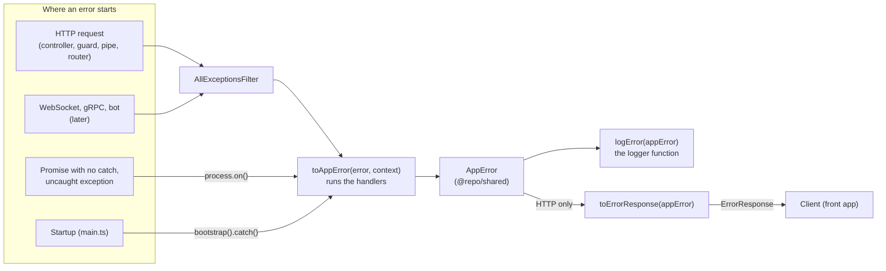
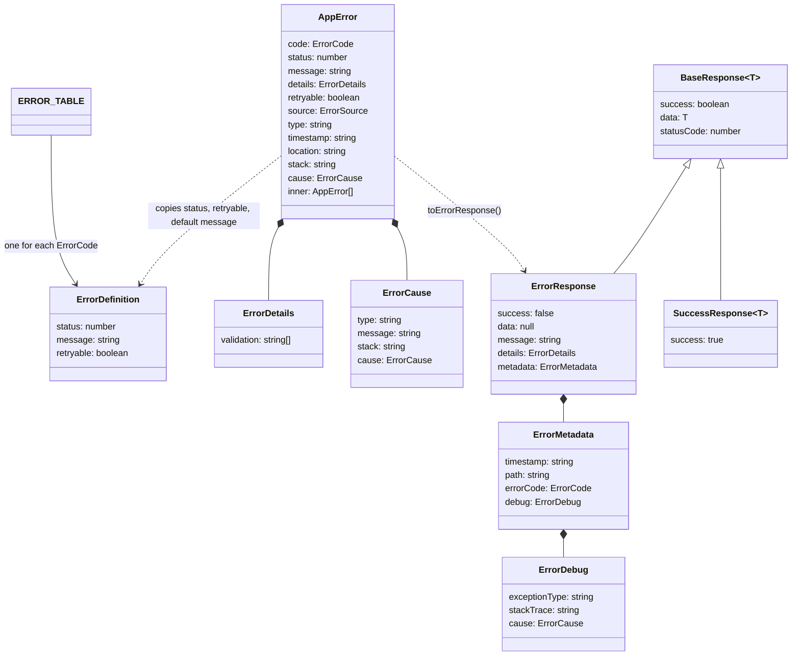
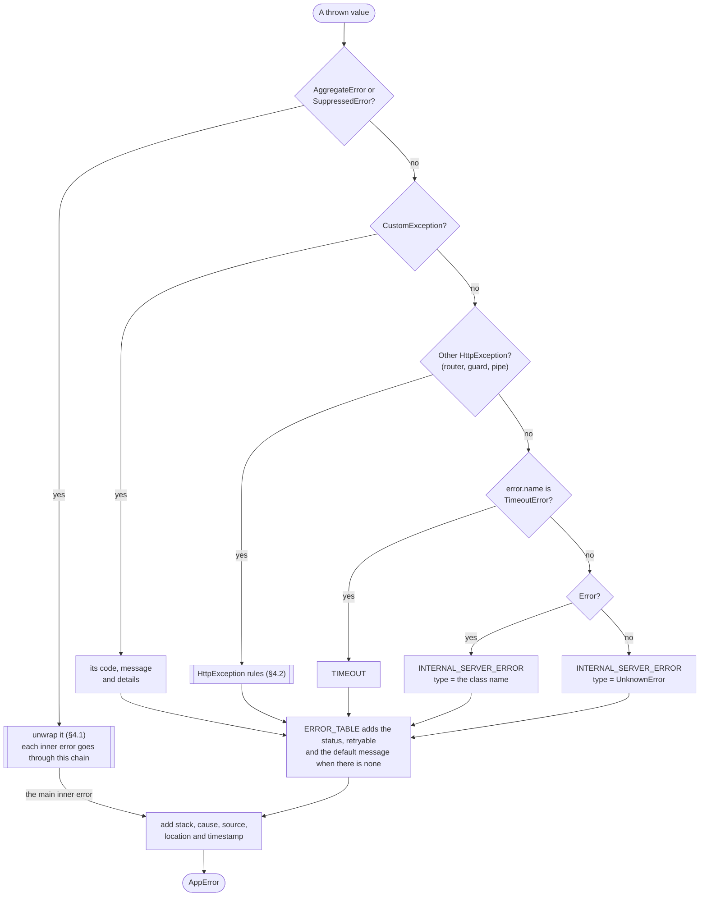
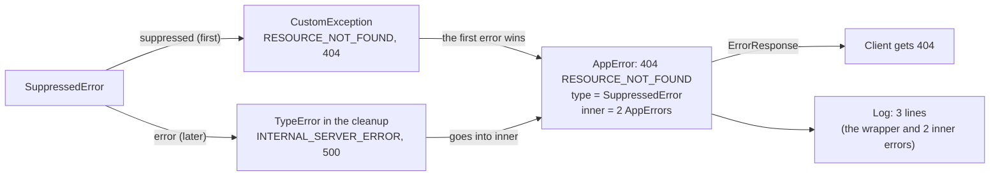
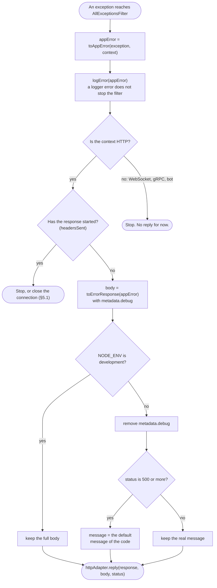
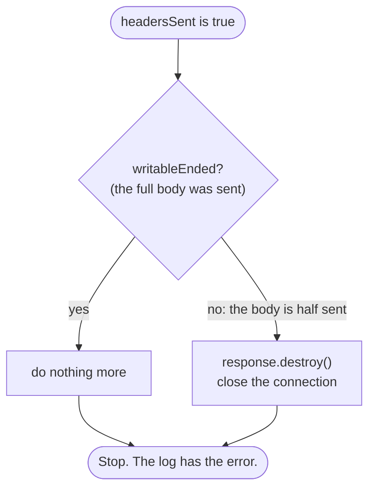
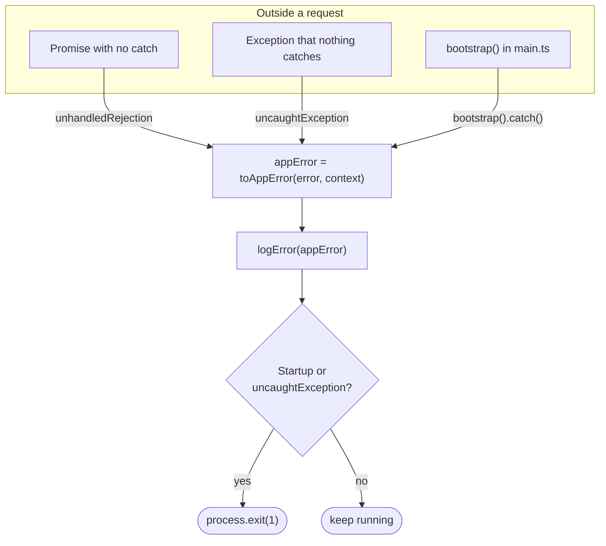

# Error handling improvements

Status: reviewed. The specs are the changes `261124-0853`, `261126-1154`, `261126-1155` and `261126-1156` (§10). There is no code yet.

This page is the design of the error handling and of the response body of the back app. It combines 3 inputs:

- [`my-thought.md`](my-thought.md) ("my-thought 1" is item 1 of its list),
- your answers to the questions Q1–Q9 of 2026-11-26,
- the earlier review of `AllExceptionsFilter` ("earlier 1" is its improvement 1).

The old plan in [`error-handling.md`](error-handling.md) is out of date. §9 lists the decisions that I made when I wrote the specs.

Two words have different meanings on this page:

- **client**: the program that sends the request, for example the front app.
- **customer**: the person who uses the front app.

## 1. The improvements

| #   | Improvement                                                                                                                                          | Source                     | Change                       |
| --- | ---------------------------------------------------------------------------------------------------------------------------------------------------- | -------------------------- | ---------------------------- |
| 1   | Each error becomes one `AppError` object. A small handler converts each error type.                                                                  | my-thought 1               | `261124-0853`                |
| 2   | One table of error codes. Each code has a status, a default message and a retry flag.                                                                | my-thought 2               | `261124-0853`                |
| 3   | One table of default messages for HTTP statuses. The front app uses it for a response with no error code.                                            | Q6                         | `261124-0853`                |
| 4   | Each error response has an `errorCode`. A NestJS exception gets the code of its status.                                                              | my-thought 4               | `261124-0853`                |
| 5   | The message is the custom message. Without one, it is the default message of the code. Outside development, a 5xx response gets the default message. | Q1, Q2, Q3                 | `261124-0853`, `261126-1154` |
| 6   | `details` tells the client what to do to fix the error. Now it holds the validation messages.                                                        | Q1                         | `261124-0853`, `261126-1154` |
| 7   | `cause` keeps the error that caused an error, for example the error of another site.                                                                 | Q5                         | `261124-0853`                |
| 8   | `exceptionName` is removed. `exceptionType`, `stackTrace` and `cause` are debug fields. Only development gets them.                                  | my-thought 3, 6, Q4        | `261126-1154`                |
| 9   | Logging is a separate function. The filter gets it in its constructor. A log line has no line breaks.                                                | my-thought 5, Q7           | `261124-0853`, `261126-1154` |
| 10  | `AggregateError` and `SuppressedError` are unwrapped (§4.1).                                                                                         | Q9                         | `261124-0853`                |
| 11  | The response has already started: the filter logs the error and closes the connection (§5.1).                                                        | Q8                         | `261126-1154`                |
| 12  | A context that is not HTTP (WebSocket, gRPC, bot): the filter logs the error. It sends no reply.                                                     | earlier 1                  | `261126-1154`                |
| 13  | `path` has no query string, in the response and in the log.                                                                                          | earlier 4                  | `261124-0853`, `261126-1154` |
| 14  | Each success response has the shape `{ success: true, data, statusCode }`. `BaseResponse` is the parent of the success and the error response.       | your message of 2026-11-26 | `261126-1155`                |
| 15  | An error outside a request (a promise with no `catch`, an uncaught exception, startup) uses the same `AppError` and logger.                          | earlier review             | `261126-1156`                |
| 16  | The names of the security tests have the SEC IDs of the security guide (`docs/security/guide.md`, PR #2).                                            | earlier 6                  | all                          |

## 2. Big picture



- The filter is only one entry point. `toAppError` and `logError` are plain functions in `apps/back/src/common/errors/`, so `main.ts` can use them too.
- `AppError` is the inside view of an error: it has all the details. `ErrorResponse` is the outside view: only the safe fields.
- A request with no error goes through `ResponseInterceptor`. It wraps the result of the handler in a `SuccessResponse` (§3.4).

## 3. Shared types (`@repo/shared`)

The front app and the back app use the same types. Each value is plain data (no class, no `Error` object), so `JSON.stringify` works on it.



The code blocks below show which fields are optional (`?`).

### 3.1 Default messages of HTTP statuses (Q6)

`packages/shared/src/http-status-messages.ts`. The statuses are numbers (`404`), because `@repo/shared` cannot import NestJS. The back app can still write `HttpStatus.NOT_FOUND`, because its value is `404`.

```ts
/** The default text of an HTTP error status, for the customer. */
export const HTTP_STATUS_MESSAGES: Readonly<Partial<Record<number, string>>> = {
  400: 'The request is not valid.',
  401: 'Sign in to continue.',
  403: 'You do not have access.',
  404: 'Not found.',
  408: 'The request took too long.',
  409: 'The request conflicts with the current data.',
  413: 'The request is too large.',
  422: 'The request data is not valid.',
  429: 'Too many requests. Try again later.',
  500: 'Sorry, something bad happened. Try again.',
  502: 'An external service failed. Try again later.',
  503: 'The service is not available. Try again later.',
  504: 'The request took too long. Try again later.',
};
```

- The front app shows it when a response has no error code, for example a `502` page of a proxy, or no response at all.
- The generic codes of `ERROR_TABLE` (§3.2) use these texts, so one status has one text.

### 3.2 The table of error codes

`packages/shared/src/error-codes.ts`. This is your `STATUS_BY_CODE` (my-thought 2), with the default message and the retry flag added.

| Code                      | Status | Default message                              | Retry | Who uses it                      |
| ------------------------- | ------ | -------------------------------------------- | ----- | -------------------------------- |
| `BAD_REQUEST`             | 400    | The request is not valid.                    | no    | NestJS 400, other 4xx            |
| `VALIDATION_FAILED`       | 400    | The request data is not valid.               | no    | `ValidationPipe` (message list)  |
| `UNAUTHORIZED`            | 401    | Sign in to continue.                         | no    | NestJS 401                       |
| `FORBIDDEN`               | 403    | You do not have access.                      | no    | NestJS 403                       |
| `NOT_FOUND`               | 404    | Not found.                                   | no    | NestJS 404, unknown route        |
| `RESOURCE_NOT_FOUND`      | 404    | The item was not found.                      | no    | `CustomException`                |
| `RESOURCE_ALREADY_EXISTS` | 409    | The item already exists.                     | no    | `CustomException`, NestJS 409    |
| `TOO_MANY_REQUESTS`       | 429    | Too many requests. Try again later.          | yes   | NestJS 429 (rate limit)          |
| `INTERNAL_SERVER_ERROR`   | 500    | Sorry, something bad happened. Try again.    | no    | each unexpected error, other 5xx |
| `EXTERNAL_API_ERROR`      | 502    | An external service failed. Try again later. | yes   | HTTP client handler, NestJS 502  |
| `TIMEOUT`                 | 504    | The request took too long. Try again later.  | yes   | `TimeoutError`, NestJS 504       |

```ts
export const ErrorCodes = {
  BAD_REQUEST: 'BAD_REQUEST',
  RESOURCE_NOT_FOUND: 'RESOURCE_NOT_FOUND',
  // ...
} as const;

export type ErrorCode = (typeof ErrorCodes)[keyof typeof ErrorCodes];

export interface ErrorDefinition {
  status: number; // the HTTP status of the code
  message: string; // the default message, for the customer
  retryable: boolean; // true: the same request can work later
}

/** The compiler asks for one row for each code. */
export const ERROR_TABLE: Readonly<Record<ErrorCode, ErrorDefinition>> = {
  BAD_REQUEST: { status: 400, message: HTTP_STATUS_MESSAGES[400]!, retryable: false },
  RESOURCE_NOT_FOUND: { status: 404, message: 'The item was not found.', retryable: false },
  // ...
};

/** The code of a NestJS exception that has no code of its own (my-thought 4). */
export const CODE_BY_STATUS: Readonly<Partial<Record<number, ErrorCode>>> = {
  400: 'BAD_REQUEST',
  401: 'UNAUTHORIZED',
  403: 'FORBIDDEN',
  404: 'NOT_FOUND',
  409: 'RESOURCE_ALREADY_EXISTS',
  429: 'TOO_MANY_REQUESTS',
  500: 'INTERNAL_SERVER_ERROR',
  502: 'EXTERNAL_API_ERROR',
  504: 'TIMEOUT',
};

/** True when the value is a code of ERROR_TABLE. */
export function isErrorCode(value: unknown): value is ErrorCode {
  return typeof value === 'string' && Object.hasOwn(ERROR_TABLE, value);
}
```

- One status can have more than one code (`404`: `NOT_FOUND` and `RESOURCE_NOT_FOUND`). So `CODE_BY_STATUS` gives one default code for each status.
- A status that is not in `CODE_BY_STATUS` (for example `413`) keeps its status. Its code is `BAD_REQUEST` (4xx) or `INTERNAL_SERVER_ERROR` (5xx).
- The default message has three jobs. An error with no message gets it. Outside development, it replaces the message of each 5xx response (§5). The front app can show it, because the table is shared.
- A hint for the client that is the same for each error of a code goes into the table, as `retryable` does now. Add a column when the front app needs one, for example `action` (Q1).

### 3.3 `AppError`, `details` and `cause`

`packages/shared/src/app-error.ts`:

```ts
export type ErrorSource = 'http' | 'ws' | 'rpc' | 'graphql' | 'other' | 'job' | 'startup' | 'process';

/** What the client must do to fix the error. Each key is optional. */
export interface ErrorDetails {
  /** The validation messages of the request data. The customer fixes these fields. */
  validation?: string[];
  // Add a key when the front app needs it, for example: action?: 'retry' | 'sign-in';
}

/** The error that caused an error (`error.cause`). */
export interface ErrorCause {
  type: string; // 'Error', 'AxiosError'
  message: string;
  stack?: string;
  cause?: ErrorCause; // the next error of the chain. The chain stops after 3 errors.
}

export interface AppError {
  code: ErrorCode;
  status: number; // from ERROR_TABLE. A NestJS exception keeps its own status.
  message: string; // the real message. Without one, the default message of the code.
  details?: ErrorDetails;
  retryable: boolean; // from ERROR_TABLE
  source: ErrorSource; // where the error happened
  type: string; // the class name: 'TypeError', 'NotFoundException', 'UnknownError'
  timestamp: string; // ISO 8601
  location?: string; // the HTTP path without the query, or the name of the process event
  stack?: string; // the stack of the thrown error
  cause?: ErrorCause; // log only, and the response in development
  inner?: AppError[]; // the inner errors of AggregateError and SuppressedError (§4.1). Log only.
}
```

Use it in code for retries and other runtime decisions: `if (appError.retryable) { ... }`.

**`details` (Q1).** It answers one question: "What must the client do to fix the error?" It is one typed object, not a free `Record<string, unknown>`:

- The compiler tells the front app which keys exist. A new optional key breaks nothing.
- The response sends `details` in each environment. With fixed keys, internal data cannot go into it by mistake.
- There is no second field for the customer. `message` is for the customer (a person reads it). `errorCode` and `details` are for the client (code reads them).
- A severity is usually the status (4xx is a warning, 5xx is an error). Add a key or a table column only when a code needs a different one.

**`cause` (Q5).** It keeps the error that caused this error, so you can find the problem of an API integration. The name is the JavaScript name: `new Error('message', { cause: err })`. `inner` is a different thing: the list of errors in a wrapper error (§4.1).

- `toAppError()` reads `error.cause` of each error. `CustomException` takes a cause too: `new CustomException(ErrorCodes.EXTERNAL_API_ERROR, 'The job aggregator failed', { cause: err })`.
- The log has the cause. In development, the response has it too (`metadata.debug.cause`).
- The HTTP client handler (a later change, §11) adds the data of the other site to the cause. It keeps the method, the URL without the query, the status and the first 2 KB of the body. It never keeps the headers or the request body, because they hold tokens, cookies and passwords.

The front app can use `AppError` too: its API client can turn an `ErrorResponse` or a network error into an `AppError`. That is a later front change.

### 3.4 Response bodies and `BaseResponse`

`packages/shared/src/api-response.ts`:

```ts
/** The fields of each response body of the back app. */
export interface BaseResponse<T = unknown> {
  success: boolean;
  data: T;
  statusCode: number;
}

/** The body of a request that ends with no exception (ResponseInterceptor). */
export interface SuccessResponse<T> extends BaseResponse<T> {
  success: true;
}

/** The body of a request that ends with an exception (AllExceptionsFilter). */
export interface ErrorResponse extends BaseResponse<null> {
  success: false;
  message: string; // the real message. Outside development, a 5xx response gets the default message.
  details?: ErrorDetails;
  metadata: ErrorMetadata;
}

export interface ErrorMetadata {
  timestamp: string;
  path: string; // without the query string
  errorCode: ErrorCode;
  debug?: ErrorDebug; // development only
}

/** The debug fields. Outside development, the filter removes the whole object. */
export interface ErrorDebug {
  exceptionType: string;
  stackTrace?: string;
  cause?: ErrorCause;
}

/** What the front app gets. `success` tells the two shapes apart. */
export type ApiResponse<T> = SuccessResponse<T> | ErrorResponse;
```

`exceptionName` is removed (my-thought 3). The only case where it was different from `exceptionType` was `AbortError` and `TimeoutError` (both are `DOMException`). Now `TimeoutError` has its own code, and `type` takes the `name` of a `DOMException`.

The front app reads a body like this:

```ts
const body = (await res.json()) as ApiResponse<Vacancy>;
if (body.success) {
  showVacancy(body.data);
} else {
  showError(body.message, body.details);
}
```

The success interceptor (`apps/back/src/common/interceptors/response.interceptor.ts`):

```ts
@Injectable()
export class ResponseInterceptor implements NestInterceptor {
  intercept(context: ExecutionContext, next: CallHandler): Observable<unknown> {
    if (context.getType() !== 'http') return next.handle(); // a WebSocket message keeps its shape
    const response = context.switchToHttp().getResponse<Response>();
    return next.handle().pipe(
      map((data) =>
        data instanceof StreamableFile
          ? data // a file goes out as it is
          : ({ success: true, data: data ?? null, statusCode: response.statusCode } satisfies SuccessResponse<unknown>),
      ),
    );
  }
}
```

- `app.module.ts` registers it with `APP_INTERCEPTOR`, so the e2e tests get it too.
- `statusCode` is `response.statusCode`. NestJS 12 sets the status (`@HttpCode()`, `201` for `POST`) before the interceptors run.
- An exception does not go through `map()`. The filter makes its body.
- `GET /` now returns `{ "success": true, "data": "Hello World!", "statusCode": 200 }`, not the text `Hello World!`.

## 4. Handlers: from any error to `AppError`

A handler knows one error type. It picks the code and reads the message. The table gives the status, the retry flag and the default message, so a handler cannot invent a status.

```ts
export interface ErrorHandler {
  canHandle(error: unknown): boolean;
  handle(error: unknown): HandledError;
}

export interface HandledError {
  code: ErrorCode;
  type: string;
  status?: number; // only a NestJS exception has its own status
  message?: string; // the real message, when the error has a text
  details?: ErrorDetails;
  cause?: unknown; // only when the cause is not in error.cause (§4.2)
}

export interface ErrorContext {
  source: ErrorSource;
  location?: string;
}
```

`toAppError()` asks the handlers in order. The first handler that says "yes" wins. The last two handlers always say "yes", so each value gets an `AppError`.



| Handler                                                          | When                                               |
| ---------------------------------------------------------------- | -------------------------------------------------- |
| `AggregateError`, `SuppressedError` (a step before the handlers) | now                                                |
| `CustomException`                                                | now                                                |
| `HttpException`                                                  | now                                                |
| HTTP client (axios or fetch)                                     | the first change that calls a job site or LinkedIn |
| Telegram, gRPC, WebSocket                                        | the change that adds the bot, gRPC or WebSocket    |
| `TimeoutError` (`AbortSignal.timeout()`, RxJS `timeout()`)       | now                                                |
| `Error`, other values                                            | now (the last two, they always match)              |

A new error type needs only a new handler in the list. The filter does not change.

`toAppError()` never throws. An error inside the error handling gives no reply at all. For example, `String(Object.create(null))` throws `TypeError`. So `toAppError()` has a `try`/`catch`. When a handler fails, the result is `INTERNAL_SERVER_ERROR` with the type `UnknownError`.

### 4.1 Errors that hold other errors

Two built-in errors hold other errors inside them:

| Error             | Where it comes from                                                                                                                            | Inner errors                                                        |
| ----------------- | ---------------------------------------------------------------------------------------------------------------------------------------------- | ------------------------------------------------------------------- |
| `AggregateError`  | `Promise.any()`, when each promise fails. Code can also throw it to report many errors at once. (`Promise.all()` throws only the first error.) | `.errors` (a list)                                                  |
| `SuppressedError` | `using` and `await using` (automatic cleanup). The block throws error A, then the cleanup (`[Symbol.dispose]`) throws error B.                 | `.suppressed` is A (the first error), `.error` is B (the later one) |

The names in `SuppressedError` are confusing: `suppressed` is the original error, and `error` is the error of the cleanup.

Without a special step, the `Error` handler takes both of them. Then the client gets `500`, even when the inner error is a `CustomException` with `404`. So `toAppError()` unwraps them first, before the handlers. Each inner error goes through the handlers (§4) and becomes its own `AppError`. Then one inner error is the main error (Q9):

| Wrapper           | The main error                                                                                                                                                                                 |
| ----------------- | ---------------------------------------------------------------------------------------------------------------------------------------------------------------------------------------------- |
| `SuppressedError` | Always `.suppressed`, the first error. It started the exception, so its code wins, also when it is `INTERNAL_SERVER_ERROR`.                                                                    |
| `AggregateError`  | The first inner error with a code that is not `INTERNAL_SERVER_ERROR`. The order does not matter. With no such error: `INTERNAL_SERVER_ERROR` (`500`) and the message of the `AggregateError`. |

- The result has the code, the status, the message, the `details` and the retry flag of the main error. `type`, `stack` and `cause` come from the wrapper. `inner` has all the inner `AppError`s (log only).
- `inner` keeps at most 10 errors, so a big `Promise.any()` does not fill the log.
- A wrapper in a wrapper is unwrapped too, to a depth of 3.
- Node 22 has no global `SuppressedError`, so `error instanceof SuppressedError` throws `ReferenceError`. TypeScript with `target: ES2023` does not know the type either. So the check uses `error.name`.



When the block throws a `TypeError` and the cleanup throws a `CustomException` with `404`, the client gets `500`: the first error wins.

```ts
const MAX_DEPTH = 3;
const MAX_INNER = 10;

export function toAppError(error: unknown, context: ErrorContext, handlers = backErrorHandlers, depth = 0): AppError {
  try {
    if (depth < MAX_DEPTH && isSuppressedError(error)) {
      const first = toAppError(error.suppressed, context, handlers, depth + 1);
      const later = toAppError(error.error, context, handlers, depth + 1);
      return fromWrapper(error, first, [first, later], context);
    }
    if (depth < MAX_DEPTH && error instanceof AggregateError) {
      const inner = error.errors.slice(0, MAX_INNER).map((e) => toAppError(e, context, handlers, depth + 1));
      const main = inner.find((e) => e.code !== 'INTERNAL_SERVER_ERROR');
      return fromWrapper(error, main ?? internalError(error), inner, context);
    }
    return runHandlers(error, context, handlers); // §4
  } catch {
    return fallbackAppError(context); // INTERNAL_SERVER_ERROR, type UnknownError
  }
}

/** Node 22 has no global SuppressedError, so `instanceof` throws ReferenceError. */
function isSuppressedError(error: unknown): error is Error & { error: unknown; suppressed: unknown } {
  return error instanceof Error && error.name === 'SuppressedError' && 'suppressed' in error && 'error' in error;
}
```

`toAppError()` does not unwrap `error.cause`: it only copies it to `cause` (§3.3). For example, a failed `fetch` throws `TypeError: fetch failed`, and its `cause` is an `AggregateError` (one inner error for each IP address of the host). The HTTP client handler takes that error as one error: `EXTERNAL_API_ERROR`.

### 4.2 `HttpException` rules

NestJS throws an `HttpException` for the router, the guards and the pipes. Each rule list is a chain: the first rule that matches wins.

The code:

1. The status is not 400–599, for example `new HttpException('Moved', 302)`: `INTERNAL_SERVER_ERROR` and the status `500`. Express can throw `Invalid status code` inside the filter for such a status.
2. `exception.errorCode` (an option of NestJS 12) is a code of `ERROR_TABLE`: that code.
3. The message is a list, and the status is `400`: `VALIDATION_FAILED`.
4. `CODE_BY_STATUS` has the status: that code.
5. Else: `BAD_REQUEST` (4xx) or `INTERNAL_SERVER_ERROR` (5xx).

The exception keeps its own status, except in rule 1.

The message (`exception.getResponse()`):

1. It is a text: that text.
2. It is an `Error`, for example `new UnauthorizedException(err)`: the default message of the code. `err` goes to `cause`. The text of `err` can have internal details. NestJS does the same.
3. Its `message` is a list: the default message of the code. The list goes to `details.validation`.
4. Its `message` is a text: that text.
5. Else: the default message of the code.

Then one more step: the router message of an unknown route is `Cannot GET /x?token=abc`. The handler removes the query (`Cannot GET /x`), because a token in the query must not go to the log.

A NestJS exception always has a text. For example, `new ForbiddenException()` has the message `Forbidden`. So it keeps that text, not the default message of the table. The front app can show the default message of the code when it wants.

## 5. The filter step by step



- The log comes first, so an error that gets no reply (not HTTP, or the response has started) is still in the log.
- When the logger throws, the filter writes one line with `console.error` and continues. A bug in a logger must not leave the client with no reply.
- `NODE_ENV` is `development`: the filter keeps the full `ErrorResponse` (the real `message` and `metadata.debug`) and sends the reply.
- `NODE_ENV` is not `development`: the filter removes `metadata.debug` in one step. Then a new debug field cannot reach production by mistake. Then it checks the status. A status of 500 or more: it replaces `message` with the default message of the code (§3.2). A lower status keeps the real message.
- So in production, `new InternalServerErrorException(err.message)` does not show `err.message` to the client.
- A 4xx message goes to the client in each environment. Write it for the customer, and do not put internal details (an ID of another user, a file path, a token) into it.
- A 5xx custom message, for example of `new CustomException(ErrorCodes.EXTERNAL_API_ERROR, 'Aggregator X failed')`, shows only in development. When the customer must see a special text, use a 4xx code or a key of `details`.
- When `NODE_ENV` is not set, the filter uses the rules for production. That is the safe default. `pnpm dev` sets `NODE_ENV=development` (§9, D13).
- `path` is `request.originalUrl` without the part from `?`.

The handlers and the logger go into the filter constructor (my-thought 1 and 5, Q7):

```ts
@Catch()
export class AllExceptionsFilter implements ExceptionFilter {
  constructor(
    private readonly httpAdapterHost: HttpAdapterHost,
    @Inject(ERROR_HANDLERS) private readonly handlers: ErrorHandler[],
    @Inject(ERROR_LOGGER) private readonly logError: ErrorLogger,
  ) {}
}
```

```ts
// app.module.ts
providers: [
  { provide: ERROR_HANDLERS, useValue: backErrorHandlers }, // common/errors/error-handlers.ts
  { provide: ERROR_LOGGER, useValue: logError }, // common/errors/error-logger.ts
  { provide: APP_FILTER, useClass: AllExceptionsFilter },
  { provide: APP_INTERCEPTOR, useClass: ResponseInterceptor },
],
```

To change the log shape, change `logError` in `error-logger.ts`. `main.ts` imports the same function (§7), so both places get the new shape.

### 5.1 The response has already started (Q8)

An HTTP response goes out in 2 parts. First the status and the headers (`200 OK`, `Content-Type: text/csv`). Then the body. After part 1 is out, the status cannot change. Almost each error happens before part 1, so the filter sends `404` and the JSON body as usual.

| Example                                                                       | What happens                                                                                                                                                                                                                      | What the filter does                                   |
| ----------------------------------------------------------------------------- | --------------------------------------------------------------------------------------------------------------------------------------------------------------------------------------------------------------------------------- | ------------------------------------------------------ |
| A CSV download: `200` goes out, 5,000 rows are sent, then the database fails. | A JSON error written now goes into the CSV file, and the status stays `200`: the browser saves a broken file as a success. A normal end makes a short file that looks complete. Only a closed connection shows "download failed". | Log, then `response.destroy()` (close the connection). |
| A handler sends the reply with `@Res()`, then throws.                         | The client already has the full response (`writableEnded`).                                                                                                                                                                       | Log only.                                              |
| Live updates with SSE or WebSocket: the channel is open, and messages go out. | These channels carry messages, so the server can send one more message: an error.                                                                                                                                                 | Later (§11): send an `error` message, then close.      |



NestJS 12 does the same for a `StreamableFile`: when the file stream fails after the start, it closes the connection.

## 6. Logging

The logger is one function:

```ts
export type ErrorLogger = (error: AppError) => void;
```

The filter does not know how the log looks. The logger decides. Now there is one logger, `logError`. It uses the NestJS `Logger` and writes one text line.

| `AppError`                                                                       | Level   | Fields in the line                                               |
| -------------------------------------------------------------------------------- | ------- | ---------------------------------------------------------------- |
| status 500 or more, an inner error with 500 or more, or the source is not `http` | `error` | status, code, source, location, real message, type, stack, cause |
| status 400 to 499, source `http`                                                 | `warn`  | status, code, source, location, real message                     |

Example lines (outside development):

```text
WARN  404 RESOURCE_NOT_FOUND http /vacancies/42 "Vacancy 42 not found"
ERROR 500 INTERNAL_SERVER_ERROR http /vacancies/42 "Cannot read properties of undefined (reading 'id')" type=TypeError stack="TypeError: ...\n    at ..."
ERROR 502 EXTERNAL_API_ERROR http /vacancies "The job aggregator failed" type=CustomException stack="..." cause="Error: connect ECONNREFUSED 10.0.0.5:443"
```

An `AppError` with `inner` (§4.1) gives one line for the wrapper and one line for each inner error:

```text
ERROR 404 RESOURCE_NOT_FOUND http /vacancies/42 "Vacancy 42 not found" type=SuppressedError inner=2
ERROR   inner 1/2: 404 RESOURCE_NOT_FOUND CustomException "Vacancy 42 not found"
ERROR   inner 2/2: 500 INTERNAL_SERVER_ERROR TypeError "Cannot read properties of undefined (reading 'close')" stack="TypeError: ...\n    at ..."
```

- **No line breaks outside development.** A user can put a line break into a URL or a form field. In the log, that line break can start a fake log line (SEC-03.10). So the logger changes each `\r` and `\n` in a text to the 2 characters `\n`. One error is one line.
- **Development:** the stack goes on extra lines (the second argument of `Logger.error()`), so you can read it. A fake log line on your own PC is no risk.
- **The logger never throws.** When the NestJS `Logger` fails, `logError` writes the line with `console.error`.
- A JSON logger and Sentry come later (§11). Each one is one more function of the type `ErrorLogger`.

## 7. Errors outside the filter

The filter catches only errors of a request. Other code needs its own `catch`. It uses the same `toAppError` and `logError`.



```ts
// common/errors/process-error-handlers.ts
export function registerProcessErrorHandlers(target = process, log = logError, exit = process.exit) {
  target.on('unhandledRejection', (reason) => log(toAppError(reason, { source: 'process', location: 'unhandledRejection' })));
  target.on('uncaughtException', (error) => {
    log(toAppError(error, { source: 'process', location: 'uncaughtException' }));
    exit(1); // the state of the app is not known, so stop it
  });
}

export function handleStartupError(error: unknown, log = logError, exit = process.exit) {
  log(toAppError(error, { source: 'startup' }));
  exit(1);
}
```

```ts
// main.ts
registerProcessErrorHandlers();
bootstrap().catch((error) => handleStartupError(error));
```

- An unhandled promise rejection: log it and keep running. By default, Node stops the process. One failed background promise must not stop the app for all users.
- An uncaught exception or a startup error: log it, then `process.exit(1)`.
- A promise with no `await` (fire and forget) gets `.catch()`: `void sendEmail().catch((e) => logError(toAppError(e, { source: 'job', location: 'send-email' })))`. The oxlint rule `no-floating-promises` already finds a promise with no `await`.
- The parameters `target`, `log` and `exit` let a unit test use an `EventEmitter` and spies.

## 8. Response examples

A business error. The request was `GET /vacancies/42?token=abc`:

```json
{
  "success": false,
  "data": null,
  "statusCode": 404,
  "message": "Vacancy 42 not found",
  "metadata": {
    "timestamp": "2026-11-26T08:00:00.000Z",
    "path": "/vacancies/42",
    "errorCode": "RESOURCE_NOT_FOUND"
  }
}
```

The service threw `new CustomException(ErrorCodes.RESOURCE_NOT_FOUND, 'Vacancy 42 not found')`. Without the text, the message is the default message `The item was not found.`

A validation error. The list of the pipe is in `details.validation`, and `message` is the default message:

```json
{
  "success": false,
  "data": null,
  "statusCode": 400,
  "message": "The request data is not valid.",
  "details": { "validation": ["name must be a string", "url must be a URL"] },
  "metadata": {
    "timestamp": "2026-11-26T08:00:00.000Z",
    "path": "/companies",
    "errorCode": "VALIDATION_FAILED"
  }
}
```

An unexpected error in production (the default message, no debug fields):

```json
{
  "success": false,
  "data": null,
  "statusCode": 500,
  "message": "Sorry, something bad happened. Try again.",
  "metadata": {
    "timestamp": "2026-11-26T08:00:00.000Z",
    "path": "/vacancies/42",
    "errorCode": "INTERNAL_SERVER_ERROR"
  }
}
```

The same error in development (the real message and the debug fields):

```json
{
  "success": false,
  "data": null,
  "statusCode": 500,
  "message": "Cannot read properties of undefined (reading 'id')",
  "metadata": {
    "timestamp": "2026-11-26T08:00:00.000Z",
    "path": "/vacancies/42",
    "errorCode": "INTERNAL_SERVER_ERROR",
    "debug": {
      "exceptionType": "TypeError",
      "stackTrace": "TypeError: Cannot read properties of undefined (reading 'id')\n    at ..."
    }
  }
}
```

An error of another site in development. The service threw `new CustomException(ErrorCodes.EXTERNAL_API_ERROR, 'The job aggregator failed', { cause: err })`:

```json
{
  "success": false,
  "data": null,
  "statusCode": 502,
  "message": "The job aggregator failed",
  "metadata": {
    "timestamp": "2026-11-26T08:00:00.000Z",
    "path": "/vacancies",
    "errorCode": "EXTERNAL_API_ERROR",
    "debug": {
      "exceptionType": "CustomException",
      "stackTrace": "CustomException: The job aggregator failed\n    at ...",
      "cause": { "type": "Error", "message": "connect ECONNREFUSED 10.0.0.5:443", "stack": "Error: connect ECONNREFUSED ..." }
    }
  }
}
```

In production, the same error has the message `An external service failed. Try again later.` and no `debug`.

A success response:

```json
{
  "success": true,
  "data": { "id": 42, "title": "Backend developer" },
  "statusCode": 200
}
```

## 9. Decisions made when the specs were written

Your answers to Q1–Q9 are in the sections above. These are the problems that I found and the decisions that I made. Each one is in a `design.md` of a change.

| #   | Problem                                                                                                                                        | Decision                                                                                                                                                         |
| --- | ---------------------------------------------------------------------------------------------------------------------------------------------- | ---------------------------------------------------------------------------------------------------------------------------------------------------------------- |
| D1  | The old `AppError.cause` was the thrown error itself, not its cause.                                                                           | `stack` keeps the stack of the thrown error. `cause` keeps `error.cause`, the error that caused it (Q5).                                                         |
| D2  | The filter removed the debug fields one by one. A new debug field could reach production when somebody forgets to remove it.                   | `exceptionType`, `stackTrace` and `cause` live in one object, `metadata.debug`. Outside development, the filter removes the object.                              |
| D3  | `error instanceof SuppressedError` throws `ReferenceError` on Node 22, which has no such global. Then the error handling itself fails.         | Check `error.name === 'SuppressedError'` and the fields `suppressed` and `error`.                                                                                |
| D4  | One rule for both wrapper errors did not agree with Q9.                                                                                        | Two rules: the first error of a `SuppressedError`, the first known code of an `AggregateError` (§4.1).                                                           |
| D5  | An error inside the error handling gives no reply. For example, `String(Object.create(null))` throws.                                          | `toAppError()` and `logError()` never throw. The filter sends the reply when the logger fails.                                                                   |
| D6  | `new UnauthorizedException(err)` sends `err.message` to the client in each environment.                                                        | The default message of the code. `err` goes to `cause` (§4.2). NestJS does the same.                                                                             |
| D7  | NestJS 12 `HttpException` has an `errorCode` option. The old design did not read it.                                                           | A known `errorCode` wins over `CODE_BY_STATUS`. `CustomException` sets its code through this option.                                                             |
| D8  | A list message with a status other than 400 got `VALIDATION_FAILED`, a code of status 400.                                                     | The list always goes to `details.validation`. The code is `VALIDATION_FAILED` only for the status 400.                                                           |
| D9  | The unknown-route message `Cannot GET /x?token=abc` has the query, so the token goes to the log.                                               | The handler removes the query from this message.                                                                                                                 |
| D10 | `new HttpException('Moved', 302)` gives an error body with a 3xx status, and some statuses make Express throw inside the filter.               | A status outside 400–599 becomes `500 INTERNAL_SERVER_ERROR`.                                                                                                    |
| D11 | Two loggers (console and NestJS) and a JSON format. Nothing needs them yet.                                                                    | One logger, `logError`. JSON and Sentry come later. `app.module.ts` and `main.ts` use the same function.                                                         |
| D12 | A stack on one line is hard to read in a terminal.                                                                                             | Outside development: one error is one line. In development: the stack is on extra lines.                                                                         |
| D13 | `pnpm dev` does not set `NODE_ENV`, so you never see the full body on your PC.                                                                 | The back `dev` script sets `NODE_ENV=development`. `shellEmulator: true` in `pnpm-workspace.yaml` makes this script work on Windows too.                         |
| D14 | `runJob()` with retries: the app has no cron job or queue yet.                                                                                 | Not now. The first change with a job adds it (§11).                                                                                                              |
| D15 | By default, Node stops the process on a promise rejection with no `catch`.                                                                     | Log it and keep running. An uncaught exception and a startup error: log, then `process.exit(1)` (§7).                                                            |
| D16 | The success interceptor can send a wrong `statusCode`, break a file download, or change a WebSocket message.                                   | It reads `response.statusCode`, which NestJS 12 sets before the interceptors. It does not wrap a `StreamableFile` or a context that is not HTTP.                 |
| D17 | The old design did not say where `path` comes from.                                                                                            | `path` and `location` are `request.originalUrl` without the part from `?`.                                                                                       |
| D18 | A NestJS exception always has a text (`Forbidden`), so it never gets the default message of the table.                                         | It keeps the NestJS text. The front app can show the default message of the code.                                                                                |
| D19 | `AllExceptionsFilter` replaces the NestJS default filter. That filter knew the errors of Express middleware, for example `413` of body-parser. | No new handler is necessary. NestJS 12 converts these errors (status below 500) to an `HttpException` before any filter. I checked this in `express-adapter.js`. |
| D20 | GraphQL is in your stack. A filter that returns nothing in a GraphQL context gives `null` with no error.                                       | `ErrorSource` has `graphql`. The change that adds GraphQL makes the reply for it (§11).                                                                          |

No question is open now.

## 10. The changes

| Order | Change                                                                                                       | Contents                                                                                                                                                                                  | Depends on    |
| ----- | ------------------------------------------------------------------------------------------------------------ | ----------------------------------------------------------------------------------------------------------------------------------------------------------------------------------------- | ------------- |
| 1     | [`261124-0853`](../openspec/changes/261124-0853-global-error-handler/proposal.md) Error model and log        | `HTTP_STATUS_MESSAGES`, `ERROR_TABLE`, `AppError`, `ErrorDetails`, `ErrorCause`, `CustomException`, `toAppError()` with the handlers, `logError()`. The HTTP responses do not change yet. | none          |
| 2     | [`261126-1154`](../openspec/changes/261126-1154-http-error-response/proposal.md) HTTP error response         | `AllExceptionsFilter`, `BaseResponse`, `ErrorResponse`, the rules for development and the other environments, the response that has started, the contexts that are not HTTP.              | `261124-0853` |
| 3     | [`261126-1155`](../openspec/changes/261126-1155-success-response/proposal.md) Success response               | `SuccessResponse`, `ApiResponse`, `ResponseInterceptor`.                                                                                                                                  | `261126-1154` |
| 4     | [`261126-1156`](../openspec/changes/261126-1156-errors-outside-requests/proposal.md) Errors outside requests | `unhandledRejection`, `uncaughtException` and startup errors.                                                                                                                             | `261124-0853` |

## 11. Later changes

| Item                                                                                    | The change that adds it                            | Rules                                                                                                                                                                        |
| --------------------------------------------------------------------------------------- | -------------------------------------------------- | ---------------------------------------------------------------------------------------------------------------------------------------------------------------------------- |
| HTTP client handler (axios or fetch)                                                    | the first change that calls a job site or LinkedIn | `EXTERNAL_API_ERROR` (502) or `TIMEOUT` (504), never the status of the other site. A service can still catch the error when it wants a better code. The cause rules of §3.3. |
| SSE or WebSocket                                                                        | the change that adds it                            | Catch the error in the stream. Send one `error` message with the `ErrorResponse`, then close. NestJS sends its own `error` event for SSE, without `logError`.                |
| File download (`StreamableFile`)                                                        | the first file endpoint                            | Give `setErrorHandler()` a function that uses `toAppError` and `logError`. Before the start, NestJS sends the text `Bad Request`, not an `ErrorResponse`.                    |
| GraphQL, gRPC, Telegram bot                                                             | the change that adds it                            | The filter gives the error back in the form of that context.                                                                                                                 |
| A route that must not be wrapped (SSE, a redirect to a URL from the handler, a webhook) | the change that adds the first one                 | A decorator `@RawResponse()` that `ResponseInterceptor` skips.                                                                                                               |
| `runJob()` with retries                                                                 | the first cron job or queue                        | `catch`, then `toAppError(error, { source: 'job', location: name })`, `logError()`, and a retry when `appError.retryable` is true.                                           |
| JSON log, Sentry                                                                        | the change that sends the logs to a service        | One more function of the type `ErrorLogger`.                                                                                                                                 |
| Request ID in the response and in the log                                               | when support must find the log line of an error    | –                                                                                                                                                                            |
| Front API client                                                                        | a front change                                     | It turns a response or a network error into an `AppError`. It uses `HTTP_STATUS_MESSAGES` for a response with no error code.                                                 |
| `details.action`, `severity`                                                            | when the front app needs them                      | An optional key of `ErrorDetails`, or a column of `ERROR_TABLE` (Q1).                                                                                                        |
