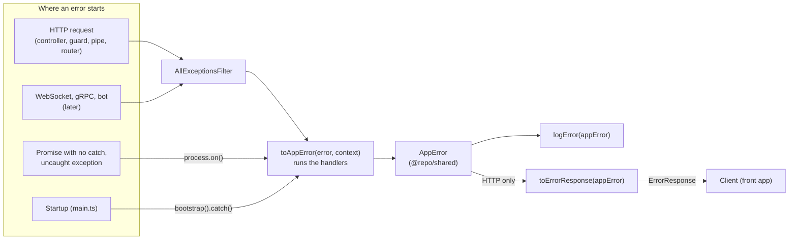
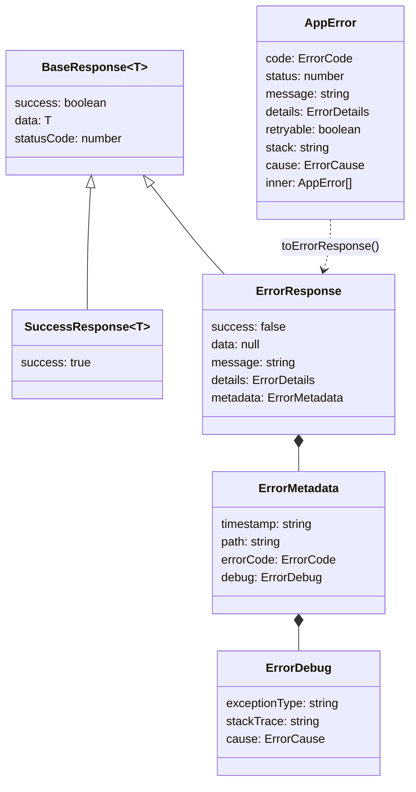
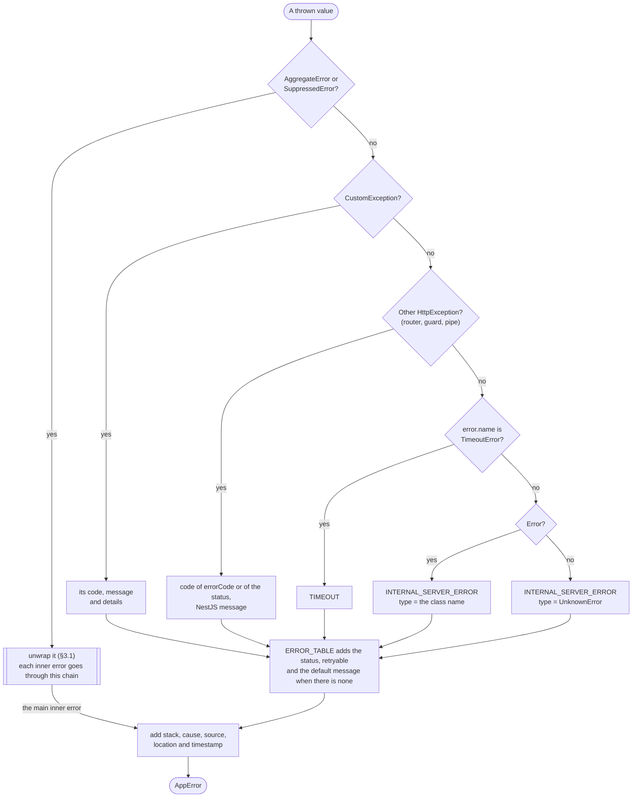
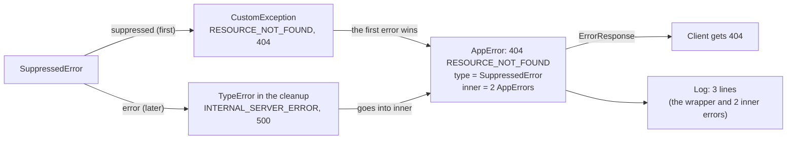
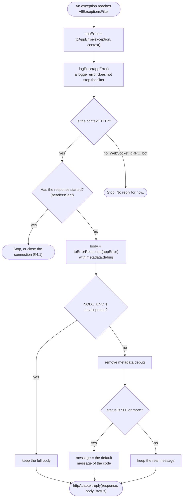
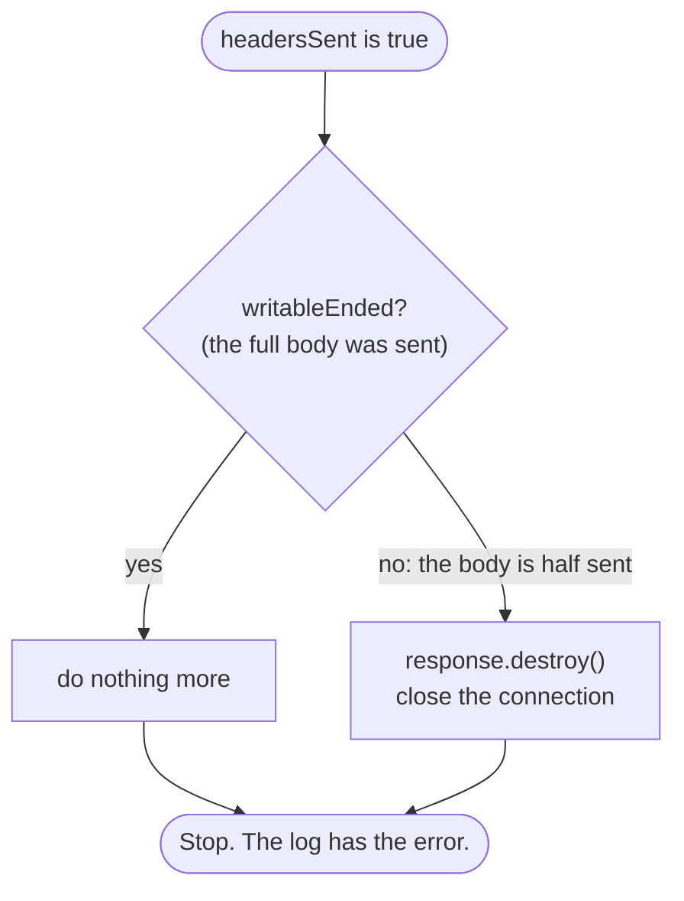
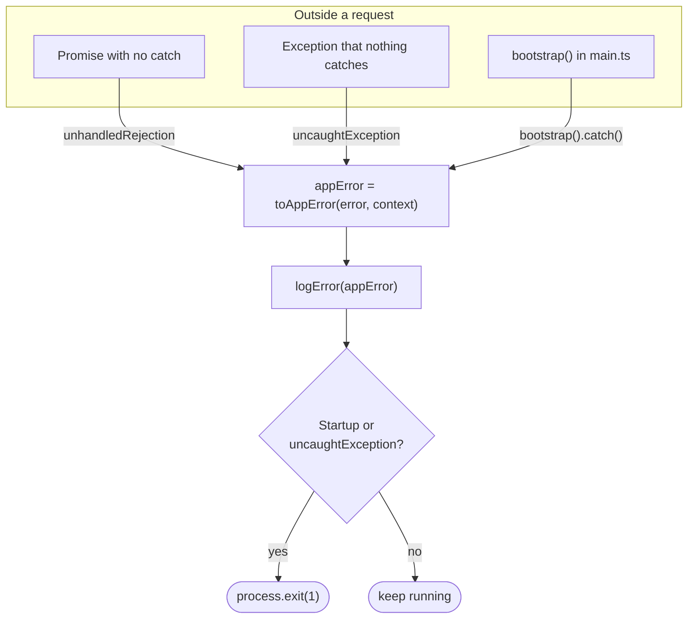

# Error handling in the back app

This page explains how the back app handles errors: where an error goes, what the client gets and what the log shows. The specs (§10) hold the code shapes, the decisions and the test scenarios.

Status: planned. The 4 changes are `Draft`, and the code does not exist yet.

**Client** is the program that sends a request (the front app). **Customer** is the person who uses the front app. The glossary is in `openspec/README.md` §10.

## 1. Big picture



- Each thrown value becomes one `AppError`. It is the inside view of the error, with all the details.
- Only the filter turns an `AppError` into an `ErrorResponse`. It is the outside view, with only the safe fields.
- `toAppError()` and `logError()` are plain functions, so code outside a request uses them too.
- A request with no error gets a success response (§6).

## 2. Parts

| Part                                                           | Where                                | Job                                                                               |
| -------------------------------------------------------------- | ------------------------------------ | --------------------------------------------------------------------------------- |
| `ERROR_TABLE`, `ErrorCodes`                                    | `@repo/shared`                       | One row for each error code: the status, the default message and the retry flag.  |
| `HTTP_STATUS_MESSAGES`                                         | `@repo/shared`                       | A default text for each HTTP error status, for a response that has no error code. |
| `AppError`, `BaseResponse`, `ErrorResponse`, `SuccessResponse` | `@repo/shared`                       | The shapes that both apps use.                                                    |
| `CustomException`                                              | `apps/back/src/common/errors/`       | What a service throws for a business error.                                       |
| Error handlers, `toAppError()`                                 | `apps/back/src/common/errors/`       | Turn any thrown value into an `AppError`.                                         |
| `logError()`                                                   | `apps/back/src/common/errors/`       | Writes the log line of an `AppError`.                                             |
| `AllExceptionsFilter`                                          | `apps/back/src/common/filters/`      | Catches each exception of a request, logs it and sends the error response.        |
| `ResponseInterceptor`                                          | `apps/back/src/common/interceptors/` | Wraps each successful result in the success response.                             |
| Process error handlers                                         | `apps/back/src/common/errors/`       | Log the errors outside a request.                                                 |



## 3. From an error to an `AppError`

`toAppError()` asks the error handlers in order. The first handler that says yes picks the code and reads the message. `ERROR_TABLE` adds the status, the retry flag and the default message, so a handler cannot invent a status. A NestJS exception keeps its own status.



What a thrown value gives:

| Thrown value                                                                 | Code                    | Status | Message                                     |
| ---------------------------------------------------------------------------- | ----------------------- | ------ | ------------------------------------------- |
| `new CustomException(ErrorCodes.RESOURCE_NOT_FOUND, 'Vacancy 42 not found')` | `RESOURCE_NOT_FOUND`    | 404    | `Vacancy 42 not found`                      |
| `new CustomException(ErrorCodes.RESOURCE_NOT_FOUND)`                         | `RESOURCE_NOT_FOUND`    | 404    | `The item was not found.` (default message) |
| `new ForbiddenException()`                                                   | `FORBIDDEN`             | 403    | `Forbidden` (the NestJS text)               |
| `new BadRequestException(['name must be a string'])`                         | `VALIDATION_FAILED`     | 400    | default message, the list in `details`      |
| `new PayloadTooLargeException()` (no code for 413)                           | `BAD_REQUEST`           | 413    | `Payload Too Large`                         |
| `new TypeError('Cannot read properties of undefined')`                       | `INTERNAL_SERVER_ERROR` | 500    | the real message                            |
| `throw 'boom'`                                                               | `INTERNAL_SERVER_ERROR` | 500    | `boom`, the type is `UnknownError`          |
| `DOMException` with the name `TimeoutError`                                  | `TIMEOUT`               | 504    | the real message                            |

- **`details`** answers one question: "What must the client do to fix the error?" Now it holds the validation list (`details.validation`). A new key is added when the front app needs it, for example an action.
- **`cause`** keeps the error that caused this error, for example the error of another site. Only the log and the response in development show it.
- **Retry:** `appError.retryable` comes from the table. Code can use it to try again.
- `toAppError()` never throws. An error inside the error handling would leave the client with no reply.

### 3.1 Errors that hold other errors

| Error             | Where it comes from                                                 | The main error (gives the code)                                              |
| ----------------- | ------------------------------------------------------------------- | ---------------------------------------------------------------------------- |
| `SuppressedError` | `using`: the block throws error A, then the cleanup throws error B. | Always A (`.suppressed`), because it started the exception.                  |
| `AggregateError`  | `Promise.any()` when each promise fails.                            | The first inner error with a known code. With none, `INTERNAL_SERVER_ERROR`. |

The inner errors go to `inner` (at most 10) and to the log, never to the response.



## 4. The HTTP error response



- The log comes first, so an error that gets no reply is still in the log.
- **Development** (`NODE_ENV=development`, which `pnpm dev` sets): the full body, with the real message and `metadata.debug` (`exceptionType`, `stackTrace`, `cause`).
- **Each other environment**, also with no `NODE_ENV`: no `metadata.debug`. A status of 500 or more gets the default message of its code, because a real 5xx message can show internal details.
- A 4xx message goes to the customer in each environment. Write it for the customer, with no internal details (a file path, a token, an ID of another user).
- `metadata.path` has no query string, so a token in the query does not go to the response or to the log.

### 4.1 The response has already started

A response goes out in 2 parts: first the status and the headers, then the body. After the first part, the status cannot change. Example: a CSV download sends `200` and 5,000 rows, then the database fails.

- A JSON error written now goes into the CSV file, and the browser saves a broken file as a success.
- So the filter only logs the error and closes the connection. The browser then shows "download failed".
- When the full body was already sent (`writableEnded`), the filter only logs.



## 5. Logging

`logError()` is the one logger. The filter and `main.ts` use the same function, so one change in `error-logger.ts` changes all log lines.

| `AppError`                                                                       | Level   |
| -------------------------------------------------------------------------------- | ------- |
| status 500 or more, an inner error with 500 or more, or the source is not `http` | `error` |
| status 400 to 499, source `http`                                                 | `warn`  |

```text
WARN  404 RESOURCE_NOT_FOUND http /vacancies/42 "Vacancy 42 not found"
ERROR 500 INTERNAL_SERVER_ERROR http /vacancies/42 "Cannot read properties of undefined (reading 'id')" type=TypeError stack="TypeError: ...\n    at ..."
ERROR 502 EXTERNAL_API_ERROR http /vacancies "The job aggregator failed" type=CustomException stack="..." cause="Error: connect ECONNREFUSED 10.0.0.5:443"
```

- Outside development, one error is one line. The logger changes each line break in a text to the 2 characters `\n`, so a user value cannot make a fake log line.
- In development, the stack goes on extra lines, so you can read it.
- A wrapper error gives one more line for each inner error.

## 6. Success response

`ResponseInterceptor` wraps the result of each HTTP handler: `{ success: true, data, statusCode }`.

- `data` is `null` when the handler returns nothing. `statusCode` is the status of the response, for example `201` for `POST`.
- A `StreamableFile` (a file download) and a WebSocket message keep their shape.
- An exception does not go through the interceptor. The filter makes its body.
- The front app checks `body.success` to tell a success response from an error response.

## 7. Errors outside a request



- A promise rejection that no code catches: log it, and the app keeps running for the other users.
- An uncaught exception or a startup error: log it, then stop the process. The state of the app is not known.
- A promise with no `await` gets its own `.catch()` with `toAppError()` and `logError()`. The oxlint rule `no-floating-promises` finds a promise with no `await`.

## 8. Examples

Throw a business error from a service. Without the text, the client gets the default message of the code:

```ts
throw new CustomException(ErrorCodes.RESOURCE_NOT_FOUND, 'Vacancy 42 not found');
throw new CustomException(ErrorCodes.EXTERNAL_API_ERROR, 'The job aggregator failed', { cause: error });
```

A new error code is a new row of `ERROR_TABLE` in `packages/shared/src/error-codes.ts`. Then both apps can use it.

A business error. The request was `GET /vacancies/42?token=abc`:

```json
{
  "success": false,
  "data": null,
  "statusCode": 404,
  "message": "Vacancy 42 not found",
  "metadata": { "timestamp": "2026-11-26T08:00:00.000Z", "path": "/vacancies/42", "errorCode": "RESOURCE_NOT_FOUND" }
}
```

A validation error:

```json
{
  "success": false,
  "data": null,
  "statusCode": 400,
  "message": "The request data is not valid.",
  "details": { "validation": ["name must be a string", "url must be a URL"] },
  "metadata": { "timestamp": "2026-11-26T08:00:00.000Z", "path": "/companies", "errorCode": "VALIDATION_FAILED" }
}
```

An error of another site in production (the default message, no debug fields):

```json
{
  "success": false,
  "data": null,
  "statusCode": 502,
  "message": "An external service failed. Try again later.",
  "metadata": { "timestamp": "2026-11-26T08:00:00.000Z", "path": "/vacancies", "errorCode": "EXTERNAL_API_ERROR" }
}
```

The same error in development (the real message and the debug fields):

```json
{
  "success": false,
  "data": null,
  "statusCode": 502,
  "message": "The job aggregator failed",
  "metadata": {
    "timestamp": "2026-11-26T08:00:00.000Z",
    "path": "/vacancies",
    "errorCode": "EXTERNAL_API_ERROR",
    "debug": {
      "exceptionType": "CustomException",
      "stackTrace": "CustomException: The job aggregator failed\n    at ...",
      "cause": { "type": "Error", "message": "connect ECONNREFUSED 10.0.0.5:443" }
    }
  }
}
```

A success response:

```json
{ "success": true, "data": { "id": 42, "title": "Backend developer" }, "statusCode": 200 }
```

## 9. Not built yet

| Item                                                      | Rule                                                                                                                                                                                       | Built by                                           |
| --------------------------------------------------------- | ------------------------------------------------------------------------------------------------------------------------------------------------------------------------------------------ | -------------------------------------------------- |
| HTTP client handler (axios or fetch)                      | `EXTERNAL_API_ERROR` (502) or `TIMEOUT` (504), never the status of the other site. `cause` keeps the method, the URL with no query, the status and the first 2 KB of the body. No headers. | the first change that calls a job site or LinkedIn |
| SSE, WebSocket                                            | Send one `error` message with the `ErrorResponse`, then close.                                                                                                                             | the change that adds it                            |
| File download (`StreamableFile`)                          | `setErrorHandler()` with `toAppError()` and `logError()`.                                                                                                                                  | the first file endpoint                            |
| GraphQL, gRPC, Telegram bot                               | The filter gives the error back in the form of that context.                                                                                                                               | the change that adds it                            |
| A route that must not be wrapped (SSE, redirect, webhook) | A decorator `@RawResponse()` that the interceptor skips.                                                                                                                                   | the first such route                               |
| Jobs with retries (`runJob()`)                            | Log with the source `job`. Try again when `appError.retryable` is true.                                                                                                                    | the first cron job or queue                        |
| JSON log, Sentry, request ID                              | One more function of the type `ErrorLogger`.                                                                                                                                               | when the logs go to a service                      |
| Front API client                                          | It turns a response or a network error into an `AppError`, and uses `HTTP_STATUS_MESSAGES` for a response with no error code.                                                              | a front change                                     |

## 10. Specs

| Order | Change                                                                                                       | Contents                                                               |
| ----- | ------------------------------------------------------------------------------------------------------------ | ---------------------------------------------------------------------- |
| 1     | [`261124-0853`](../openspec/changes/261124-0853-global-error-handler/proposal.md) Error model and error log  | Error codes, `AppError`, `CustomException`, the handlers, `logError()` |
| 2     | [`261126-1154`](../openspec/changes/261126-1154-http-error-response/proposal.md) HTTP error response         | `AllExceptionsFilter`, `ErrorResponse`, the rules for each environment |
| 3     | [`261126-1155`](../openspec/changes/261126-1155-success-response/proposal.md) Success response               | `ResponseInterceptor`, `SuccessResponse`                               |
| 4     | [`261126-1156`](../openspec/changes/261126-1156-errors-outside-requests/proposal.md) Errors outside requests | The process error handlers                                             |
