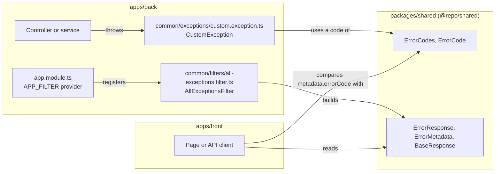
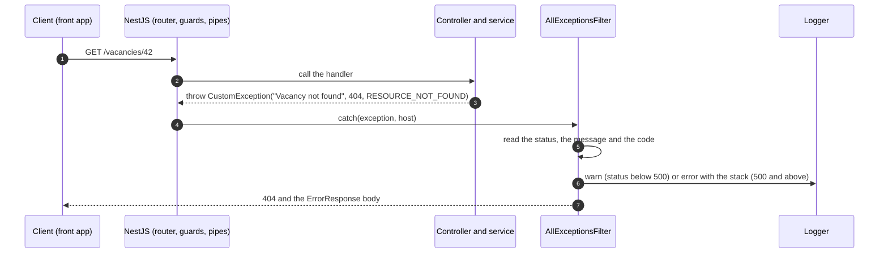
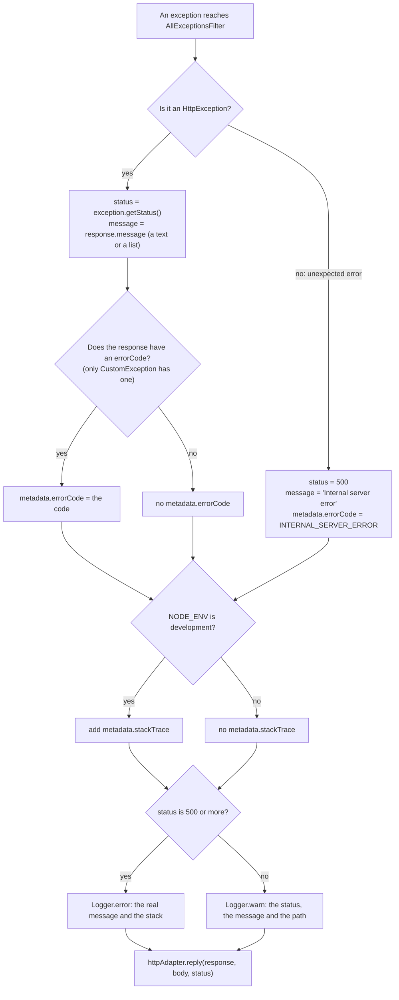

# Error handling in the back app

This page shows how the back app turns an error into one JSON error response. The rules are in the OpenSpec change [`261124-0853`](../openspec/changes/261124-0853-global-error-handler/proposal.md). The model is the error handling of the 13hunters back app.

Status: planned. The code does not exist yet.

## 1. Parts

The types live in `@repo/shared`, so the back app and the front app use the same definitions.



| Part                  | Job                                                                                  |
| --------------------- | ------------------------------------------------------------------------------------ |
| `ErrorCodes`          | The list of error codes, for example `RESOURCE_NOT_FOUND`. One list for both apps.   |
| `ErrorResponse`       | The shape of the JSON body of each error.                                            |
| `CustomException`     | What a service throws for a business error: a message, an HTTP status and a code.    |
| `AllExceptionsFilter` | The only place that turns an exception into a response. It also writes the log line. |
| `APP_FILTER`          | Makes the filter global: it runs for every route, and in the e2e tests too.          |

## 2. Flow of a failed request

The example route `GET /vacancies/42` does not exist yet. It only shows the flow.



A guard, a pipe or the router can also throw. For example, an unknown route makes NestJS throw `NotFoundException`. The same filter catches all of them.

## 3. How the filter reads an error



What goes into the response for each kind of thrown value:

| Thrown value                                               | `statusCode` | `message`                               | `errorCode`             | `exceptionType`   |
| ---------------------------------------------------------- | ------------ | --------------------------------------- | ----------------------- | ----------------- |
| `CustomException`                                          | its status   | its message                             | its code                | `CustomException` |
| Other `HttpException`, for example `NotFoundException`     | its status   | `message` of its response: text or list | –                       | its class name    |
| Other `Error`, for example `TypeError`                     | `500`        | `Internal server error`                 | `INTERNAL_SERVER_ERROR` | its class name    |
| A value that is not an `Error`, for example `throw 'boom'` | `500`        | `Internal server error`                 | `INTERNAL_SERVER_ERROR` | `UnknownError`    |

The real message of an unexpected error goes to the log only. It can contain internal details (a file path, a database message), so the client does not get it.

## 4. Error response examples

A business error (`CustomException`):

```json
{
  "success": false,
  "data": null,
  "message": "Vacancy not found",
  "statusCode": 404,
  "metadata": {
    "timestamp": "2026-11-24T08:00:00.000Z",
    "path": "/vacancies/42",
    "exceptionType": "CustomException",
    "exceptionName": "CustomException",
    "errorCode": "RESOURCE_NOT_FOUND"
  }
}
```

A validation error (a list of messages, no code):

```json
{
  "success": false,
  "data": null,
  "message": ["name must be a string", "url must be a URL"],
  "statusCode": 400,
  "metadata": {
    "timestamp": "2026-11-24T08:00:00.000Z",
    "path": "/companies",
    "exceptionType": "BadRequestException",
    "exceptionName": "BadRequestException"
  }
}
```

An unexpected error when `NODE_ENV` is `development` (in production there is no `stackTrace`):

```json
{
  "success": false,
  "data": null,
  "message": "Internal server error",
  "statusCode": 500,
  "metadata": {
    "timestamp": "2026-11-24T08:00:00.000Z",
    "path": "/vacancies/42",
    "exceptionType": "TypeError",
    "exceptionName": "TypeError",
    "errorCode": "INTERNAL_SERVER_ERROR",
    "stackTrace": "TypeError: Cannot read properties of undefined (reading 'id')\n    at ..."
  }
}
```

## 5. How to throw an error

A business error in a service:

```ts
throw new CustomException('Vacancy not found', HttpStatus.NOT_FOUND, ErrorCodes.RESOURCE_NOT_FOUND);
```

An error of a call to another site (a job aggregator, LinkedIn). Log the original error, then throw `502` with `EXTERNAL_API_ERROR`. Do not pass on the status of the other site: its `404` is not a `404` of this API.

```ts
try {
  return await this.aggregatorClient.fetchVacancies(query);
} catch (error) {
  this.logger.error('The job aggregator call failed', error instanceof Error ? error.stack : String(error));
  throw new CustomException('The job aggregator is not available', HttpStatus.BAD_GATEWAY, ErrorCodes.EXTERNAL_API_ERROR);
}
```

A new code goes into `packages/shared/src/error-codes.ts`. Then both apps can use it.

## 6. Differences from 13hunters

| 13hunters                                                                                       | This project                                                       | Why                                                                   |
| ----------------------------------------------------------------------------------------------- | ------------------------------------------------------------------ | --------------------------------------------------------------------- |
| Two filters, `HttpExceptionFilter` and `AllExceptionsFilter`. NestJS never calls the first one. | One filter, `AllExceptionsFilter`.                                 | All rules in one place.                                               |
| `app.useGlobalFilters(new ...)` in `main.ts`.                                                   | `APP_FILTER` provider in `AppModule`.                              | The e2e tests do not run `main.ts`. NestJS injects the dependencies.  |
| `ConfigService` reads `NODE_ENV`.                                                               | `process.env.NODE_ENV`.                                            | The back app has no `@nestjs/config` yet.                             |
| The response has the real message of an unexpected error.                                       | A fixed message. The real one goes to the log.                     | No internal details for the client.                                   |
| The filter has rules for Axios and Telegram errors.                                             | No such rules. A service converts the error of an external call.   | A small filter. The status of the other site is not ours.             |
| `ErrorResponse` lives in the back app. The front app has its own copy.                          | `ErrorResponse` and `ErrorCodes` live in `@repo/shared`.           | One definition for both apps.                                         |
| `errorCode?: string`.                                                                           | `errorCode?: ErrorCode`.                                           | The compiler finds a misspelled code.                                 |
| `BaseResponseInterceptor` wraps each success response in `{ success: true, data, statusCode }`. | Not in this change. A success response is the data of the handler. | This change is about errors only. A later change can add the wrapper. |
