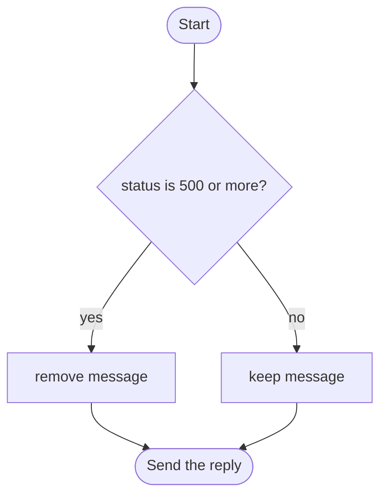

# Diagram rules

Follow these rules when you draw a diagram in a spec, a design or a doc. The diagrams are Mermaid code blocks. The rules use the basics of ISO 5807 (flowchart symbols) and common flowchart practice (sources at the end).

## 1. Choose the diagram type

| You show                                       | Use               |
| ---------------------------------------------- | ----------------- |
| Steps and decisions of one function or process | `flowchart TD`    |
| Parts of the system and the data between them  | `flowchart LR`    |
| Calls between parts in time order              | `sequenceDiagram` |
| Types and their fields                         | `classDiagram`    |
| States of one object                           | `stateDiagram-v2` |
| Tables and relations                           | `erDiagram`       |

One diagram shows one idea. When a flowchart has more than about 15 nodes, split it. Use a subroutine node (`[[...]]`) for the part that has its own diagram.

## 2. Symbols (flowchart)

Use one shape for one meaning. Do not use other shapes.

| Meaning                          | Shape      | Mermaid       |
| -------------------------------- | ---------- | ------------- |
| Start or end (terminal)          | Stadium    | `A(["text"])` |
| Action, process step             | Rectangle  | `A["text"]`   |
| Decision (a yes/no question)     | Rhombus    | `A{"text?"}`  |
| Call of a function or other flow | Subroutine | `A[["text"]]` |
| Database, store                  | Cylinder   | `A[("text")]` |

## 3. Flow

1. One direction for the whole diagram: top to bottom (`TD`) for steps, left to right (`LR`) for parts. Do not mix them.
2. One start. Each path ends at a terminal (stadium). The diagram has no dead end.
3. The main path goes straight down (or right). A side path goes away from it and comes back to it lower down.
4. A loop goes back up on one side. It does not cross other edges.
5. No crossing edges. When edges cross, change the order of the nodes or split the diagram.
6. Each node has a path from the start and a path to an end.

## 4. Decisions

1. The text of a decision is a short question that ends with `?`, for example `status is 500 or more?`.
2. A decision has exactly two outgoing edges: `yes` and `no`. For more answers, see rule 6.
3. Label each outgoing edge of a decision. Use the words `yes` and `no` (lowercase). Add a short reason after a colon when it helps: `no: WebSocket, gRPC, bot`.
4. **Same side for each decision.** `yes` goes to the left (or down), `no` goes to the right. In Mermaid, write the `yes` edge first and the `no` edge second, for each decision.
5. **Each branch goes to its own node.** Do not draw an edge from a decision directly to the node where the branches join. The layout engine then puts that edge on a random side. Add a node for the branch that does nothing, for example `keep message`.
6. A decision with more than two answers becomes a chain of yes/no decisions. Do not write a question like `What next?`.
7. A chain of checks where the first match wins (if, else if) is a staircase: each `yes` goes down and left to its result, each `no` goes right to the next check.
8. Do the checks in the same order as the code. A diagram that shows a different order is a bug in the spec.

Example:

## 5. Text

1. Node text is short: a verb and an object (`remove message`), or a function call (`logError(appError)`).
2. Use the names of the code (functions, fields, codes) in backticks in the prose, and as plain text in the node.
3. Use ` ` for a second line. A node has at most 3 lines.
4. Use the terms of the glossary (`README.md` §10).
5. Put text in quotes: `A["text"]`. Then `(`, `)`, `{`, `}` and `:` in the text do not break the diagram.
6. Do not use the word `end` alone as a node ID or a node text. It closes a subgraph in Mermaid.
7. Label an edge only when it adds information: each decision edge, and data or a condition on other edges.

## 6. Style

1. No colors and no `style` or `classDef` lines, except when a legend explains them. Color is never the only sign of a meaning.
2. Node IDs are short and stable (`A`, `B`, `H1`). The text tells the meaning, not the ID.
3. Write the nodes and edges in the order of the flow. This gives the layout engine a good start.
4. Write the outgoing edges of a node right after the edge that makes the node. When a branch node is on the wrong side, this usually fixes it.
5. A subgraph title is short (a folder or one or two words). The nodes cut off a long title.

## 7. Check

Before you commit a diagram:

1. Render it (GitHub preview, WebStorm Markdown preview, or [mermaid.live](https://mermaid.live)).
2. Walk each path from the start to an end. Each decision has `yes` and `no`, on the same sides as the other decisions.
3. No edge crosses another edge. No node is cut off.
4. The prose and the code next to the diagram tell the same order and the same names.

## Sources

- ISO 5807:1985, Documentation symbols and conventions for data, program and system flowcharts: https://www.iso.org/standard/11955.html
- Mermaid flowchart syntax: https://mermaid.js.org/syntax/flowchart.html
- Creately, flowchart rules: https://creately.com/guides/flowchart-rules/
- Nulab, flowchart rules: https://nulab.com/learn/design-and-ux/keep-it-simple-follow-flowchart-rules-for-better-diagrams
- Creately, flowchart mistakes (yes down, no right): https://creately.com/blog/software-teams/part-1-15-mistakes-you-would-unintentionally-make-with-flowcharts/
